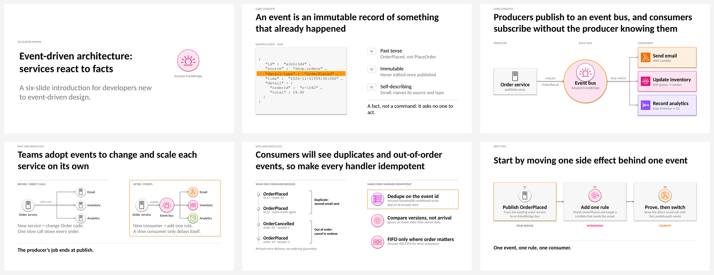
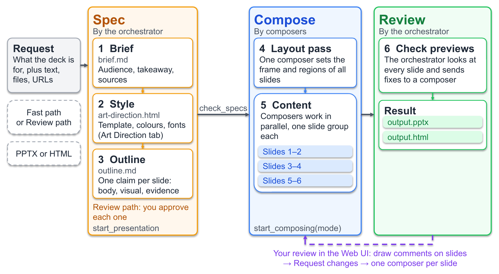
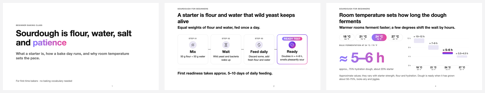
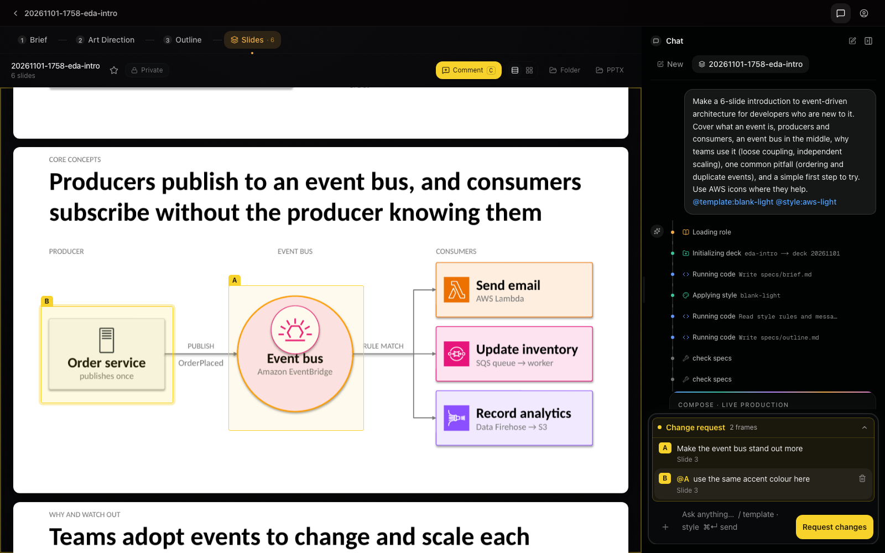
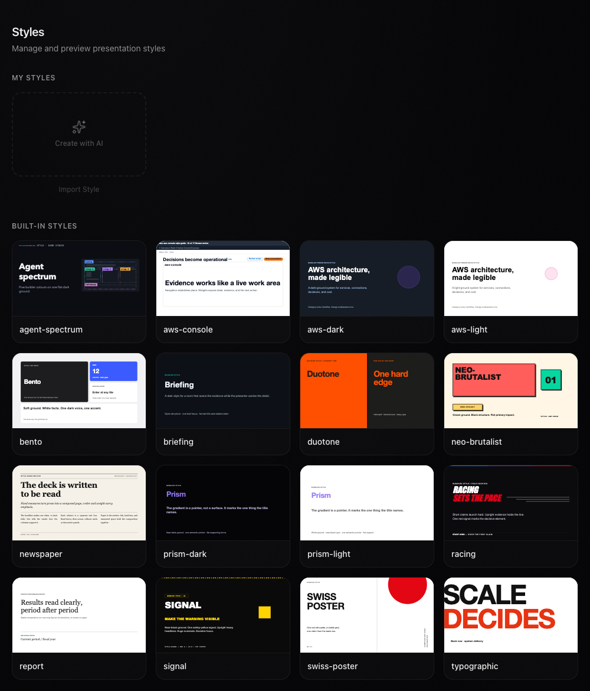
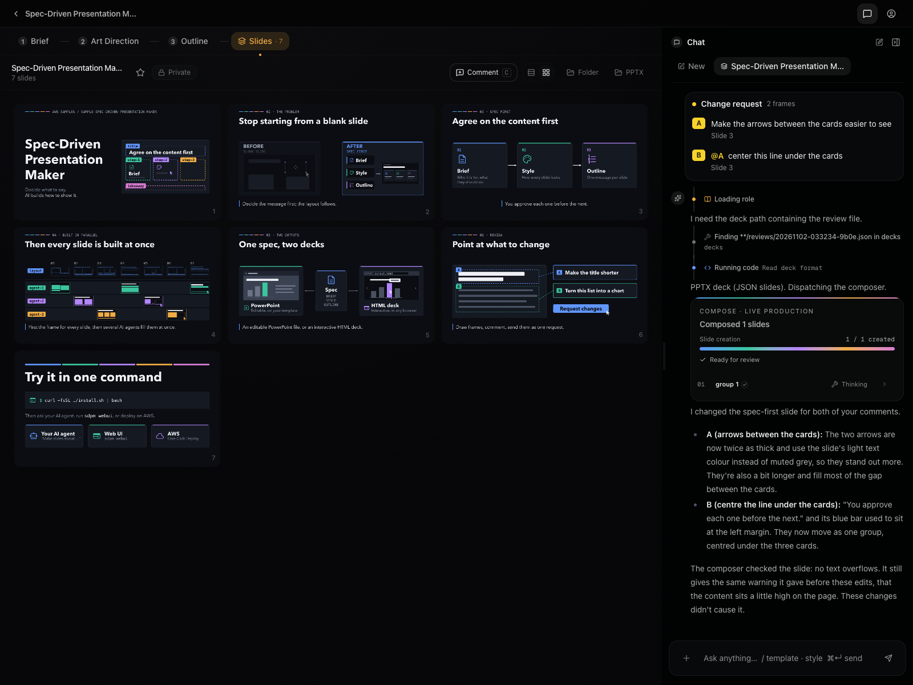

> 📝 [日本語版 README はこちら](README_ja.md)

# Spec-Driven Presentation Maker

[](LICENSE)
[](https://github.com/aws-samples/sample-spec-driven-presentation-maker/actions/workflows/ci.yml)

Turn your material into slides with an AI agent. The agent first writes a short spec (who
the talk is for, how it looks, what each slide says), then builds a PowerPoint file or a
browser (HTML) presentation from it.



*A sample deck made with SDPM: a six-slide introduction to event-driven architecture, in
the bundled `aws-light` style.*

---

## What you can do

### Spec first, then slides

Before building any slide, the agent writes a spec in three parts:

- **Brief**: who the audience is, what they should take away, and which sources to use.
- **Style**: the template, colours and fonts, and how slides look. The Web UI shows it as
  **Art Direction**.
- **Outline**: one line per slide, with the slide's claim, what it shows, and where the
  facts come from.

You can review each part before any slide is built. Then one composer fixes the layout of
every slide, and several composers fill in the slides in parallel. The agent checks the
previews and sends fixes back to a composer.



There are two ways to work:

- **Fast path**: the agent builds a first draft from your material without asking questions.
- **Review path**: you shape the story with the agent first, and approve the spec before
  the slides are built.

### Ask in plain words

Describe what you want, and the agent picks the right workflow:

| Ask | What happens |
|---|---|
| "Make slides about …" | A new deck: brief → style → outline → slides → review |
| "Make it an HTML deck" | A browser presentation instead of a PPTX |
| "Edit this PPTX" | Imports an existing PPTX into an editable deck |
| "I hand-edited the PPTX, continue from it" | Brings your PowerPoint edits back into the deck (local install only) |
| "Create a style like …" | A reusable style: colours, fonts, how slides look |
| "Translate this deck to English" | A copy of the deck in another language; the original stays as it is (PPTX decks, local install only) |

You can give it PDF, Word, Excel and PowerPoint files, text files, images, and URLs.

### PowerPoint or HTML

By default the agent builds a `.pptx` file that you can edit in PowerPoint. Ask for an HTML
deck and you get a single `output.html` that runs in any browser, offline, with speaker
notes. HTML slides can include interactive charts.



### Review by drawing on the slides

In the Web UI, turn on the **Comment** tool, draw a frame around anything on a slide and
write what should change. Press **Request changes** to send all frames at once. The agent
sends one composer per slide to make the changes and replies to each comment.



### Styles and templates

SDPM comes with 15 styles and 2 blank templates. You can use your own `.pptx` as a template,
and create new styles with AI in the Web UI or by asking your agent. See
[Custom templates, styles and assets](docs/en/custom-template.md).



---

## Choose how to use it

| | What it is | What you need | Next step |
|---|---|---|---|
| **Your own AI agent** | SDPM runs as an MCP server for the agent you already use (Claude Code, Kiro CLI, Cursor, VS Code, Codex, Claude Desktop). MCP is the protocol AI agents use to call tools. | macOS, Linux or Windows. The installer adds `git` and `uv` | [Quick Start](#quick-start) |
| **The Web UI on your computer** | A chat app in your browser, with the spec, the slides and comments side by side. Runs locally, no AWS account. | The installer adds Node.js 20+ and Kiro CLI, which runs the agent | [Quick Start](#quick-start), then `sdpm webui` |
| **A team server on AWS** | The Web UI and the MCP server deployed in your AWS account, with sign-in through Amazon Cognito. | An AWS account. No local tools for One-Click Deploy | [One-Click Deploy](#one-click-deploy-on-aws) |



### One-Click Deploy on AWS

| Region | Launch |
|--------|--------|
| Tokyo (ap-northeast-1) | [](https://ap-northeast-1.console.aws.amazon.com/cloudformation/home#/stacks/create/review?stackName=SdpmDeploymentStack&templateURL=https://aws-ml-jp.s3.ap-northeast-1.amazonaws.com/asset-deployments/SdpmDeploymentStack.yaml) |
| N. Virginia (us-east-1) | [](https://us-east-1.console.aws.amazon.com/cloudformation/home#/stacks/create/review?stackName=SdpmDeploymentStack&templateURL=https://aws-ml-jp.s3.ap-northeast-1.amazonaws.com/asset-deployments/SdpmDeploymentStack.yaml) |
| Oregon (us-west-2) | [](https://us-west-2.console.aws.amazon.com/cloudformation/home#/stacks/create/review?stackName=SdpmDeploymentStack&templateURL=https://aws-ml-jp.s3.ap-northeast-1.amazonaws.com/asset-deployments/SdpmDeploymentStack.yaml) |

The [Deploy guide](docs/en/deploy-cloudshell.md) explains the parameters and the other ways
to deploy, and [Cost Estimates](docs/en/cost.md) shows what it costs per month.

---

## Quick Start

One command installs SDPM on your computer, into `~/.sdpm`:

```bash
# macOS / Linux
curl -fsSL https://raw.githubusercontent.com/aws-samples/sample-spec-driven-presentation-maker/main/scripts/install/dist/install.sh | bash
```

```powershell
# Windows (PowerShell; verified in CI only)
irm https://raw.githubusercontent.com/aws-samples/sample-spec-driven-presentation-maker/main/scripts/install/dist/install.ps1 | iex
```

The installer asks two things: whether to add the browser Web UI, and which of the AI agents
it found on your computer to connect. Then start:

| With | Do this |
|---|---|
| Your AI agent (Claude Code, Cursor, VS Code, Codex) | Ask it **"Make slides about …"**. To connect another agent later: `sdpm register` |
| Kiro CLI | `kiro-cli chat --agent sdpm` (the installer creates this dedicated agent) |
| Your browser | Run `kiro-cli login` once, then `sdpm webui` |
| Claude Desktop | [Download `sdpm.mcpb`](https://github.com/aws-samples/sample-spec-driven-presentation-maker/releases/latest/download/sdpm.mcpb) and double-click it (no installer needed) |

`sdpm` shows what is installed and connected, `sdpm update` updates it, and `sdpm uninstall`
removes it. Slide previews need LibreOffice and poppler; the installer offers them.

The [Getting Started](docs/en/getting-started.md) guide covers the installer options, each
AI agent, and the Web UI.

---

## Workshop

A hands-on workshop walks you through making slides from URLs, PDFs, CSV files, meeting
notes and more. It has scenarios for manufacturing, financial services, healthcare, IT and
other industries.

📖 **[Workshop](https://catalog.us-east-1.prod.workshops.aws/workshops/a275330a-0ae0-40b2-ad35-264e263c3882/en-US)**

---

## Documentation

**Use it**

| Document | What it covers |
|---|---|
| [Getting Started](docs/en/getting-started.md) | Install, connect your AI agent, use the Web UI, HTML decks |
| [Custom Templates, Styles & Assets](docs/en/custom-template.md) | Your own `.pptx` templates, styles and icons |

**Run it on AWS for a team**

| Document | What it covers |
|---|---|
| [Deploy guide](docs/en/deploy-cloudshell.md) | One-Click Deploy and deploying from AWS CloudShell (no local CDK or Docker) |
| [Cost Estimates](docs/en/cost.md) | Monthly cost breakdown and how to lower it |
| [Security](docs/en/security.md) | What the stack sets up and what to review before production |
| [Measuring Usage](docs/en/usage-measurement.md) | Tokens and slide counts per user |
| [Uninstall](docs/en/uninstall.md) | Remove the deployed AWS resources |

**Develop or integrate**

| Document | What it covers |
|---|---|
| [Developer guide](docs/en/developer-guide.md) | Work from a checkout, deploy with the CDK |
| [Architecture](docs/en/architecture.md) | Layers, data flow, auth model, MCP tool reference |
| [Connecting Agents](docs/en/add-to-gateway.md) | Connect MCP clients and gateways to SDPM |
| [Teams & Slack Integration](docs/en/teams-slack-integration.md) | Use SDPM from chat platforms |
| [Web UI](web-ui/README.md) | The React Web UI, Local mode and Cloud mode |
| [Contributing](CONTRIBUTING.md) | How to send a change |

**Upgrade from an older version**

| Document | What it covers |
|---|---|
| [Migration guides](docs/en/migration/README.md) | Moving from plugins, skills or `uvx` setups, and from v0.4 / v0.5 |
| [CHANGELOG](CHANGELOG.md) | Every change, by release |

---

## Contributing

Contributions are welcome. See [CONTRIBUTING.md](CONTRIBUTING.md) for the setup and the
checks to run.

## Code of Conduct

This project has adopted the [Amazon Open Source Code of Conduct](https://aws.github.io/code-of-conduct).

## Security

This is sample code for demonstration and education, not for production use as is. Before
you deploy it, review [Security](docs/en/security.md) with your security and legal teams.
To report a potential vulnerability, follow
[CONTRIBUTING.md](CONTRIBUTING.md#security-issue-notifications) instead of opening a public
issue.

## License

This project is licensed under the [MIT-0 License](LICENSE).
