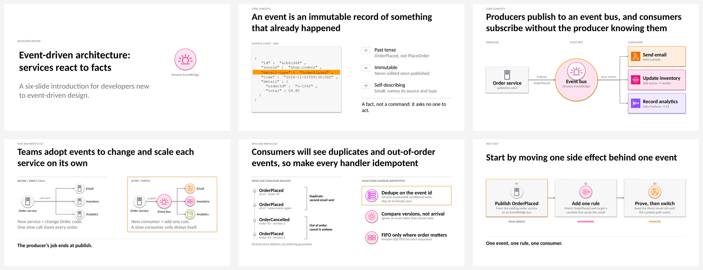
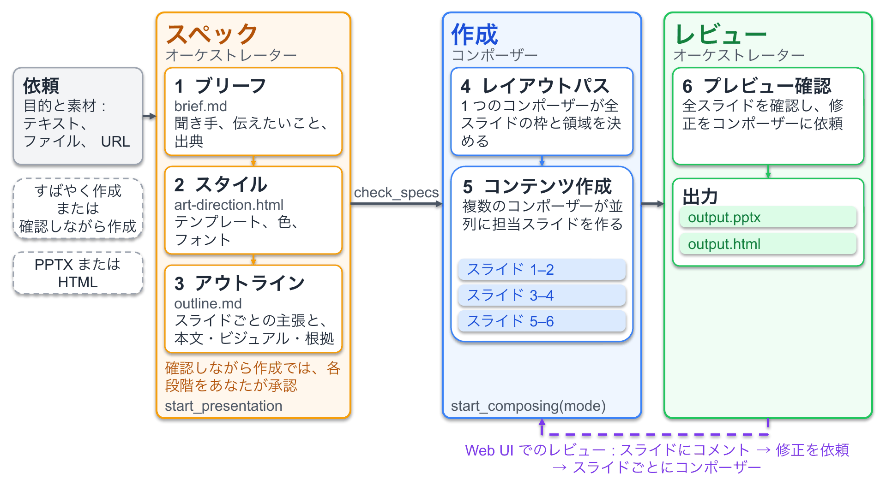
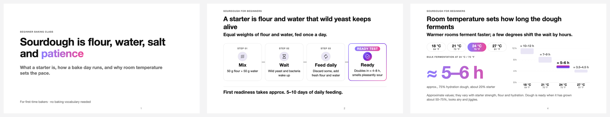
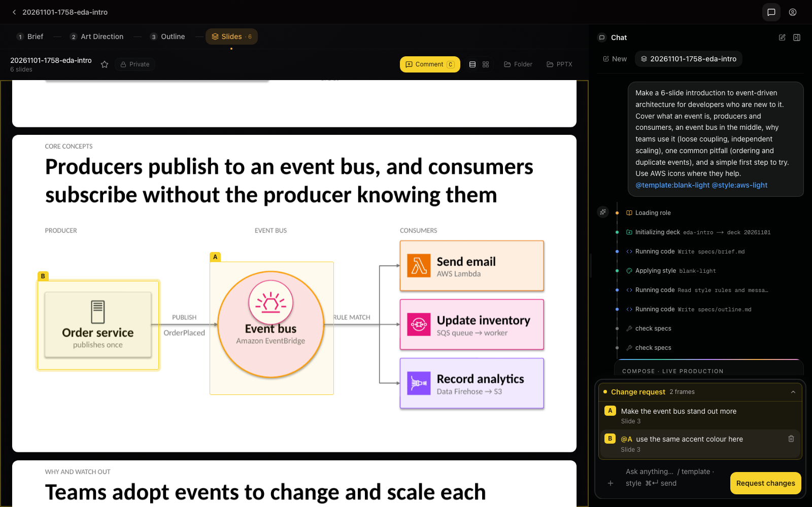
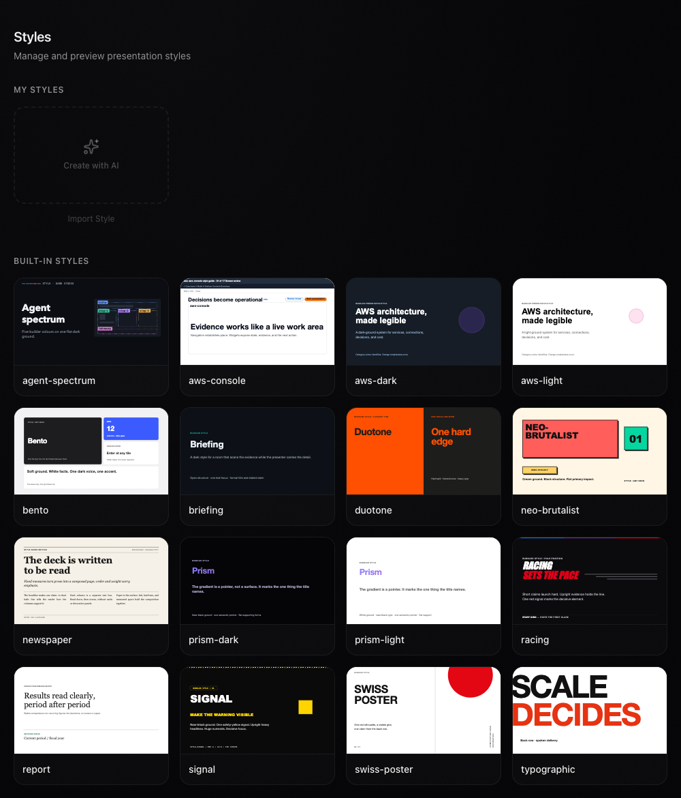
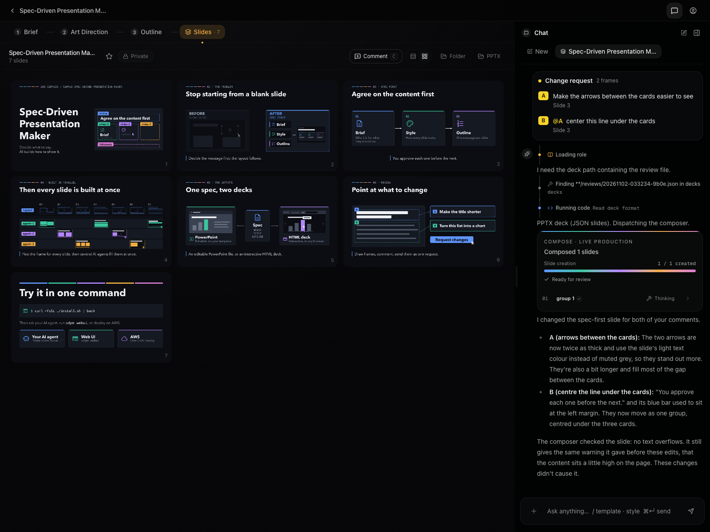

[English](README.md) | [日本語](README_ja.md)

# Spec-Driven Presentation Maker

[](LICENSE)
[](https://github.com/aws-samples/sample-spec-driven-presentation-maker/actions/workflows/ci.yml)
[](https://aws.amazon.com/jp/blogs/news/spec-driven-presentation-maker-ja/)

手元の資料から、AI エージェントがスライドを作ります。エージェントはまず短いスペック（誰に向けた
発表か、どんな見た目にするか、各スライドで何を言うか）を書き、それをもとに PowerPoint ファイルか
ブラウザで見せる HTML プレゼンテーションを組み立てます。

> 📝 コンセプトと背景は AWS ブログ [Spec-Driven Presentation Maker — 伝えたいことを先に設計し、スライド構築は AI に任せる](https://aws.amazon.com/jp/blogs/news/spec-driven-presentation-maker-ja/) もあわせてご覧ください。



*SDPM で作ったサンプルデッキ。イベント駆動アーキテクチャを紹介する 6 枚で、同梱の `aws-light`
スタイルを使っています。*

---

## できること

### 先にスペック、それからスライド

スライドを作る前に、エージェントは 3 つのパートからなるスペックを書きます。

- **ブリーフ**: 聞き手は誰か、何を持ち帰ってほしいか、どの資料を使うか。
- **スタイル**: テンプレート、配色とフォント、スライドの見せ方。Web UI では
  **アートディレクション** として表示されます。
- **アウトライン**: 1 スライド 1 行。そのスライドの主張、見せるもの、根拠の出どころ。

スライドを作る前に、それぞれを確認できます。その後、1 つのコンポーザーが全スライドのレイアウトを
決め、複数のコンポーザーが並列で中身を作ります。エージェントはプレビューを確認し、直す点を
コンポーザーに戻します。



進め方は 2 つあります。

- **すばやく作成**: 質問なしで、素材から初稿を作ります。
- **確認しながら作成**: 先にエージェントとストーリーを固め、スペックを確認してからスライドを作ります。

### 普段の言葉で頼む

やりたいことを伝えれば、エージェントが合ったワークフローを選びます。

| 頼み方 | 動作 |
|---|---|
| 「〜のスライドを作って」 | 新しいデッキ: ブリーフ → スタイル → アウトライン → スライド → レビュー |
| 「HTML のデッキにして」 | PPTX の代わりにブラウザで見るプレゼンテーション |
| 「この PPTX を編集して」 | 既存の PPTX を編集できるデッキとして取り込み |
| 「PowerPoint で手直ししたので続きを」 | PowerPoint での修正をデッキに反映（ローカルインストールのみ） |
| 「〜みたいなスタイルを作って」 | 再利用できるスタイル: 配色、フォント、スライドの見せ方 |
| 「このデッキを英語に翻訳して」 | 別の言語のコピーを作成。元のデッキはそのまま（PPTX デッキ、ローカルインストールのみ） |

素材には PDF、Word、Excel、PowerPoint、テキストファイル、画像、URL を使えます。

### PowerPoint か HTML か

既定では、PowerPoint で編集できる `.pptx` ファイルを作ります。HTML のデッキを頼むと、
どのブラウザでもオフラインで開ける `output.html` の 1 ファイルになり、スピーカーノートも使えます。
HTML のスライドには操作できるグラフも入れられます。



### スライドに描いてレビュー

Web UI で **コメント** ツールをオンにし、スライド上の気になる箇所を枠で囲んで、どう直したいかを
書きます。**修正を依頼** を押すと、すべての枠をまとめて送ります。エージェントはスライドごとに
コンポーザーを割り当てて修正し、コメントの 1 つずつに返答します。



### スタイルとテンプレート

15 のスタイルと 2 つの白紙テンプレートを同梱しています。自分の `.pptx` をテンプレートとして使えるほか、
Web UI やエージェントへの依頼で AI に新しいスタイルを作らせることもできます。詳しくは
[カスタムテンプレート・スタイル・アセット](docs/ja/custom-template.md)を参照してください。



---

## 使い方を選ぶ

| | どんなものか | 必要なもの | 次に読む |
|---|---|---|---|
| **いつもの AI エージェント** | 普段使っているエージェント（Claude Code、Kiro CLI、Cursor、VS Code、Codex、Claude Desktop）の MCP サーバーとして動きます。MCP は AI エージェントがツールを呼び出すためのプロトコルです。 | macOS、Linux、Windows。`git` と `uv` はインストーラーが入れます | [クイックスタート](#クイックスタート) |
| **手元の Web UI** | ブラウザで使うチャットアプリ。スペック、スライド、コメントを並べて扱えます。ローカルで動き、AWS アカウントは不要です。 | Node.js 20+ と、エージェントを動かす Kiro CLI（インストーラーが入れます） | [クイックスタート](#クイックスタート)の後に `sdpm webui` |
| **AWS 上のチームサーバー** | Web UI と MCP サーバーを自分の AWS アカウントにデプロイします。サインインは Amazon Cognito です。 | AWS アカウント。ワンクリックデプロイならローカルのツールは不要 | [ワンクリックデプロイ](#aws-にワンクリックデプロイ) |



### AWS にワンクリックデプロイ

| リージョン | デプロイ |
|-----------|---------|
| 東京 (ap-northeast-1) | [](https://ap-northeast-1.console.aws.amazon.com/cloudformation/home#/stacks/create/review?stackName=SdpmDeploymentStack&templateURL=https://aws-ml-jp.s3.ap-northeast-1.amazonaws.com/asset-deployments/SdpmDeploymentStack.yaml) |
| バージニア北部 (us-east-1) | [](https://us-east-1.console.aws.amazon.com/cloudformation/home#/stacks/create/review?stackName=SdpmDeploymentStack&templateURL=https://aws-ml-jp.s3.ap-northeast-1.amazonaws.com/asset-deployments/SdpmDeploymentStack.yaml) |
| オレゴン (us-west-2) | [](https://us-west-2.console.aws.amazon.com/cloudformation/home#/stacks/create/review?stackName=SdpmDeploymentStack&templateURL=https://aws-ml-jp.s3.ap-northeast-1.amazonaws.com/asset-deployments/SdpmDeploymentStack.yaml) |

パラメータとほかのデプロイ方法は[デプロイガイド](docs/en/deploy-cloudshell.md)（英語）、月額の目安は
[コスト見積もり](docs/en/cost.md)（英語）を参照してください。

---

## クイックスタート

1 コマンドで、SDPM が手元のコンピューターの `~/.sdpm` に入ります。

```bash
# macOS / Linux
curl -fsSL https://raw.githubusercontent.com/aws-samples/sample-spec-driven-presentation-maker/main/scripts/install/dist/install.sh | bash
```

```powershell
# Windows（PowerShell。CI での検証のみ）
irm https://raw.githubusercontent.com/aws-samples/sample-spec-driven-presentation-maker/main/scripts/install/dist/install.ps1 | iex
```

インストーラーが聞くのは 2 つです。ブラウザ用の Web UI も入れるか、見つかった AI エージェントの
どれに接続するか。終わったら次のように始めます。

| 使うもの | 手順 |
|---|---|
| いつもの AI エージェント（Claude Code、Cursor、VS Code、Codex） | **「〜のスライドを作って」** と頼むだけ。別のエージェントに後から接続するには `sdpm register` |
| Kiro CLI | `kiro-cli chat --agent sdpm`（インストーラーがこの専用エージェントを作ります） |
| ブラウザ | 最初に 1 度 `kiro-cli login` を実行し、`sdpm webui` |
| Claude Desktop | [`sdpm.mcpb` をダウンロード](https://github.com/aws-samples/sample-spec-driven-presentation-maker/releases/latest/download/sdpm.mcpb)してダブルクリック（インストーラー不要） |

`sdpm` で何が入っていて何に接続済みかを表示し、`sdpm update` で更新、`sdpm uninstall` で削除します。
スライドのプレビューには LibreOffice と poppler が必要で、インストーラーが導入を提案します。

インストーラーのオプション、エージェントごとの接続、Web UI の使い方は[はじめに](docs/ja/getting-started.md)にあります。

---

## ワークショップ

URL、PDF、CSV、議事録などからスライドを作るハンズオンワークショップです。製造業、金融、ヘルスケア、
IT などの業界別シナリオを収録しています。

📖 **[ワークショップ](https://catalog.us-east-1.prod.workshops.aws/workshops/a275330a-0ae0-40b2-ad35-264e263c3882/ja-JP)**

---

## ドキュメント

開発者・運用者向けのドキュメントは英語のみです。

**使う**

| ドキュメント | 内容 |
|---|---|
| [はじめに](docs/ja/getting-started.md) | インストール、AI エージェントへの接続、Web UI、HTML デッキ |
| [カスタムテンプレート・スタイル・アセット](docs/ja/custom-template.md) | 自分の `.pptx` テンプレート、スタイル、アイコン |

**AWS でチーム向けに運用する**

| ドキュメント | 内容 |
|---|---|
| [Deploy guide](docs/en/deploy-cloudshell.md) | ワンクリックデプロイと AWS CloudShell からのデプロイ（ローカルの CDK / Docker 不要） |
| [Cost Estimates](docs/en/cost.md) | 月額コストの内訳と抑え方 |
| [Security](docs/en/security.md) | スタックが設定するものと、本番前に確認すること |
| [使用量の計測](docs/ja/usage-measurement.md) | ユーザー別のトークン数とスライド作成数 |
| [アンインストール](docs/ja/uninstall.md) | デプロイした AWS リソースの削除 |

**開発・連携する**

| ドキュメント | 内容 |
|---|---|
| [Developer guide](docs/en/developer-guide.md) | checkout での開発、CDK でのデプロイ |
| [Architecture](docs/en/architecture.md) | レイヤー構成、データフロー、認証モデル、MCP ツール一覧 |
| [Connecting Agents](docs/en/add-to-gateway.md) | MCP クライアントやゲートウェイからの接続 |
| [Teams & Slack Integration](docs/en/teams-slack-integration.md) | チャットツールからの利用 |
| [Web UI](web-ui/README_ja.md) | React 製 Web UI、ローカルモードとクラウドモード |
| [Contributing](CONTRIBUTING.md) | 変更を送る手順 |

**旧バージョンから更新する**

| ドキュメント | 内容 |
|---|---|
| [Migration guides](docs/en/migration/README.md) | plugin・skill・`uvx` の構成や v0.4 / v0.5 からの移行 |
| [CHANGELOG](CHANGELOG.md) | リリースごとの全変更 |

---

## Contributing

コントリビューションを歓迎します。セットアップと実行するチェックは [CONTRIBUTING.md](CONTRIBUTING.md) を参照してください。

## Code of Conduct

This project has adopted the [Amazon Open Source Code of Conduct](https://aws.github.io/code-of-conduct).

## Security

これはデモと教育のためのサンプルコードで、そのまま本番環境で使うことは想定していません。デプロイの前に、
[Security](docs/en/security.md)（英語）をセキュリティチーム・法務チームと確認してください。
脆弱性の可能性を見つけた場合は、公開 Issue を作らず [CONTRIBUTING.md](CONTRIBUTING.md#security-issue-notifications)
の手順で報告してください。

## License

This project is licensed under the [MIT-0 License](LICENSE).
