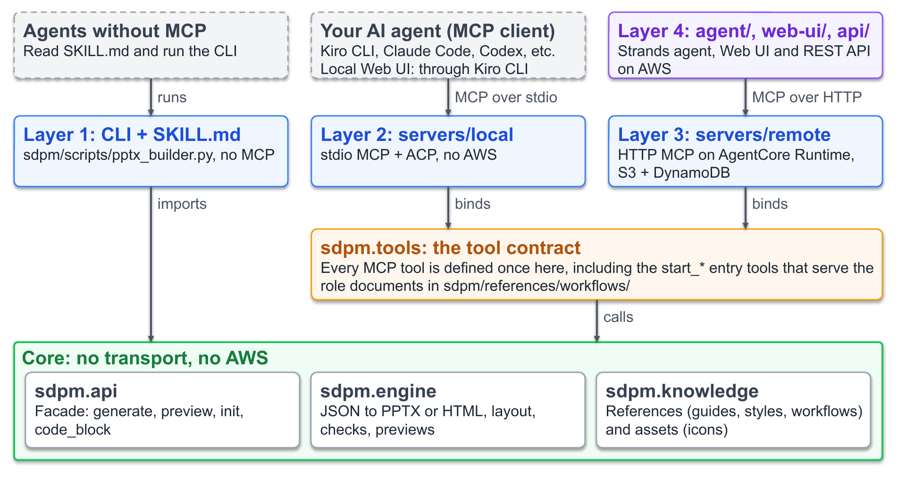
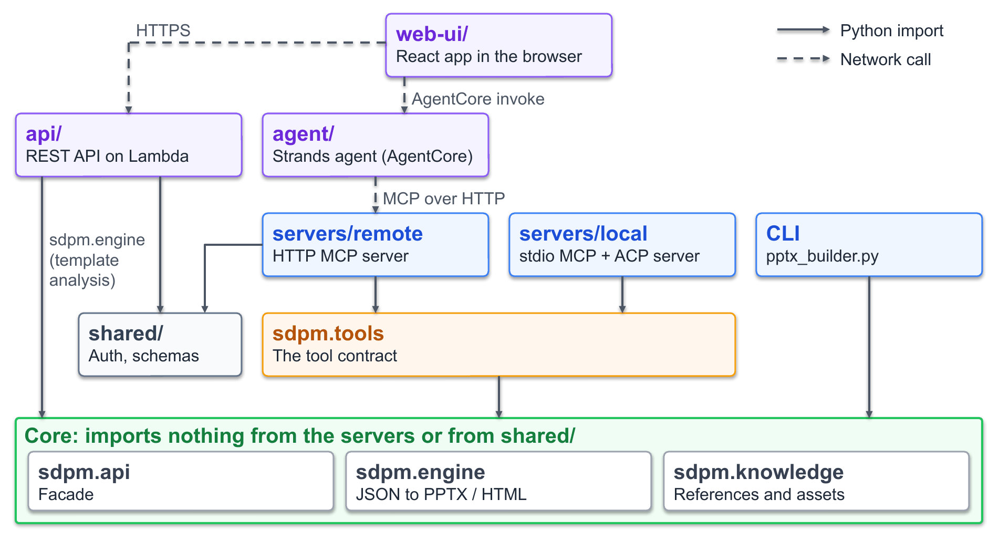
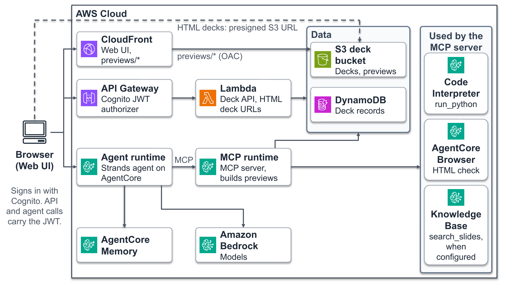
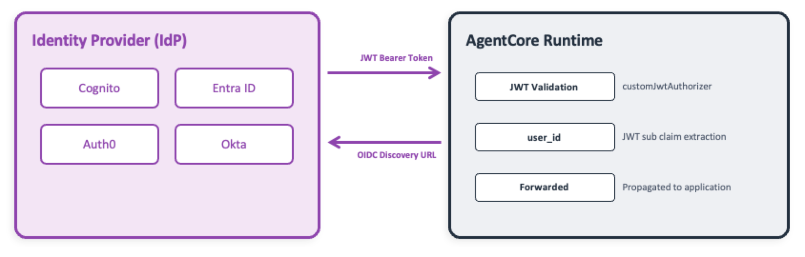
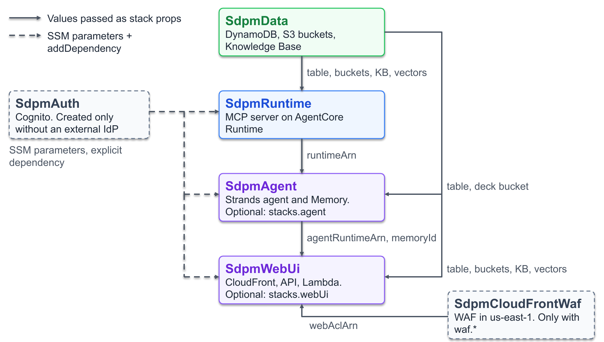

# Architecture

This document describes spec-driven-presentation-maker's overall architecture, data flow, authentication and authorization model,
data model, CDK stack structure, and deployment patterns.

---

## 4-Layer Architecture

spec-driven-presentation-maker consists of 4 layers. The engine and the tool contract
(`sdpm.tools`) sit in the middle. The local server (Layer 2) and the remote server
(Layer 3) both bind that same contract; neither wraps the other. Layer 4 (agent, Web UI,
API) uses the remote server. Use only the layers you need.



### Dependency Direction

Python imports point inward: the servers import `sdpm.tools`, which imports the engine and
knowledge. The core imports nothing from the servers or from `shared`.



---

## Entry tools, prompts and role documents

```
sdpm/        Engine (json <-> pptx) + Knowledge (references, assets, templates)
             references/workflows/ — role documents (orchestrator, composer, style,
             translate), delivered to any MCP client by the start_* entry tools
servers/     local (stdio, no AWS) / remote (HTTP, S3 + DynamoDB) — thin binds of one tool contract
             local/client_config.py wires the server into MCP clients (sdpm register)
scripts/install/   installer + `sdpm` launcher for macOS / Linux / Windows; scripts/mcpb/ the Claude Desktop bundle
agent/ api/ infra/ web-ui/   Optional AWS cloud stack (Strands Agent, REST API, CDK, React UI)
```

Each role (orchestrator, composer, style, translate) has one document in
`sdpm/references/workflows/`. The composer has one per output format: `composer.md` (PPTX)
and `composer-html.md` (HTML). A role's entry tool (`start_presentation`, `start_composing`,
`start_style`, `start_translation`) returns that document plus what the role reads first,
such as the style and template lists or the deck's specs.

An agent does not need to pick a mode: asking for slides makes it call `start_presentation`
and follow the document. The `sdpm-*` prompts (`sdpm-vibe`, `sdpm-spec`, `sdpm-style`,
`sdpm-translate`) let a user choose explicitly. Each prompt only names its role's entry tool;
the behaviour itself lives in `sdpm/references/workflows/`, in one place. The spawner
chooses the composer's mode when it dispatches one: `start_composing(..., mode="pptx"|"html")`.

Everything an agent needs (tools, workflows, guides, role behaviour) is served by the MCP
server. Nothing lives on the client side: a client only holds the one line that starts the
server, and `sdpm register` writes that line.

---

## Layer 1: Engine + Knowledge (`sdpm/`)

The core presentation engine. No network, no AWS, no MCP — just Python.

- **sdpm/sdpm/engine/** — json↔pptx conversion: builder, converter, layout engine, schema lint, preview, checks, diff, analyzer
- **sdpm/sdpm/engine/html/** — HTML output mode: converts a .pptx template to `theme.css` / `template.json` / decoration SVGs, assembles slide HTML files into a single offline `output.html` (vendored reveal.js under `sdpm/vendor/revealjs/`), and runs the static slide checks
- **sdpm/sdpm/knowledge/** — knowledge retrieval: references (guides/workflows/examples) and asset search
- **sdpm/sdpm/tools/** — the MCP tool contract: every tool's name, schema, docstring, and logic defined once; both servers register these functions directly
- **sdpm/references/** — workflows (role documents: orchestrator/composer/style/translate),
  spec (slide JSON schema), guides (design rules), examples (bundled styles)
- **sdpm/templates/** — Sample .pptx templates (dark/light)
- **sdpm/scripts/** — CLI entry point (`pptx_builder.py`), asset download scripts

Key capabilities:
- Analyze any .pptx template (layouts, colors, fonts, placeholders)
- Build slides from JSON with automatic layout optimization
- Generate PPTX files from `presentation.json`
- Convert existing PPTX back to JSON (via upload-time conversion)
- Multi-source asset search (AWS icons, Material Symbols, custom)

---

## Layer 2: Local MCP Server (`servers/local/`)

A thin bind of the `sdpm.tools` contract. Runs as a stdio server (plus an ACP variant for the local Web UI).

- Registers the contract tools via FastMCP — no tool logic of its own
- **Role entry tools `start_presentation` / `start_composing` / `start_style` / `start_translation`** — any MCP client (including ones with no skill/sub-agent mechanism, e.g. Claude Desktop) gets the role document as a tool response, together with what that role reads first (style/template catalogues; the deck's specs and assigned slides; a base style). The entry is carried by the tool surface itself, so nothing depends on skills, agent definitions or MCP Server Instructions (`SDPM_DISABLE_INSTRUCTIONS=1` turns the latter off).
- No AWS required — all files stored locally

---

## Layer 3: Remote MCP Server

The same `sdpm.tools` contract bound to an HTTP transport, with storage swapped to Amazon DynamoDB + S3 plus authentication and authorization. Bundled knowledge (references, templates) is baked into the container image; only user data (decks, uploads, user templates/styles) lives in S3/DynamoDB.

```
MCP Client → AgentCore Runtime → MCP Server Container
                                   ├── 20 MCP tools (21 with search_slides)
                                   ├── LibreOffice (PPTX → PDF/SVG)
                                   ├── DynamoDB (decks, templates)
                                   ├── S3 (PPTX, previews, references, assets)
                                   └── Code Interpreter (run_python)
```

Differences from Layer 2:
- `get_preview` — returns the preview images of a deck's slides (remote only; the local server returns previews from `run_python` as `preview_files`)
- `run_python` — runs in an Amazon Bedrock AgentCore Code Interpreter sandbox instead of a local process
- `search_slides` — semantic slide search through an Amazon Bedrock Knowledge Base, registered only when one is configured
- `start_translation` is not bound: the translate workflow runs scripts from a checkout

HTML decks (`deck.json` `outputFormat: "html"`) use the same tools with these differences:

| Tool | HTML deck behaviour |
|------|---------------------|
| `init_deck_workspace` | `output_format="html"` creates an HTML deck (default `pptx`) and returns `format_notes` (guide `html-deck`) for the orchestrator |
| `start_composing` | `mode="html"` returns the HTML composer document, the template converted for HTML and the deck's `deck.css` |
| `run_python` | After a change to an HTML build input, rebuilds `output.html` and the changed slides' thumbnails, runs the browser check on the changed slides (and `measure_slides`) and uploads thumbnails and PNGs under `html/` |
| `generate_pptx` | Finalizes the deck as HTML: full build, every thumbnail, deck record update, knowledge-base sync (`search_slides` indexes HTML slides); no browser check (every slide was checked when it was written) |
| `get_preview` | Returns the PNGs the browser check made (`html/{deckId}/png/{slug}_{epoch}.png`); a slug without one gets a text line |

The remote build reads and updates the deck record under the caller's user id, as the PPTX
build does. `run_python` / `generate_pptx` need the owner role (see
[Authorization](#authorization-role-based-access-control)), so only the deck owner rebuilds an
HTML deck on S3.
### Storage

```
DynamoDB:
  USER#{userId}/DECK#{deckId}       — deck metadata
  TEMPLATE#{id}/META                — template metadata

S3 (pptx bucket):
  decks/{deckId}/deck.json          — deck metadata (template, fonts, defaultTextColor)
  decks/{deckId}/slides/{slug}.json — per-slide data
  decks/{deckId}/specs/             — brief.md, outline.md, art-direction.html
  decks/{deckId}/includes/          — code block JSON
  decks/{deckId}/compose/           — per-slide SVG compose JSON (for Web UI animation)
  previews/{deckId}/{slideId}.png   — slide previews
  html/{deckId}/{uuid}.html         — HTML deck output.html (DynamoDB htmlS3Key)
  html/{deckId}/preview/{slug}_{epoch}.html — HTML slide thumbnails (latest epoch wins)
  template-html-cache/{cacheKey}/   — template HTML conversion (theme.css, template.json,
                                      layouts/*.svg); expires after 30 days

S3 (resource bucket):
  references/                       — examples, workflows, guides
  templates/                        — .pptx template files
  assets/                           — icons and images
```

### Deck Workspace

Using `run_python(deck_id=...)` loads the entire deck workspace into the sandbox.
The agent can read and write files using standard Python file I/O (`open`, `json.load`, etc.); modified files are written back to S3 automatically after every execution.

```
deck.json           — deck metadata (template, fonts, defaultTextColor, outputFormat)
slides/{slug}.json  — per-slide data (one file per slide, slug from outline)
slides/{slug}.html  — per-slide HTML fragment (HTML decks)
deck.css            — shared slide CSS (HTML decks)
specs/brief.md          — briefing (audience, purpose, key messages)
specs/outline.md        — one line per slide: - [slug] message
specs/art-direction.html — visual design direction (HTML style guide)
includes/           — code block JSON files
```

### Authentication

- JWT Bearer authentication via Amazon Bedrock AgentCore Runtime's `customJwtAuthorizer`
- Default is Amazon Cognito User Pool; supports any OIDC-compliant IdP
- User identity: JWT `sub` claim propagated through the entire stack
- Authorization: role-based per deck (owner / viewer)

### Preview Generation

The MCP Server container includes LibreOffice and poppler-utils for synchronous preview generation.
When `generate_pptx` is called, previews are generated inline:

```
generate_pptx:
  1. Build PPTX from deck workspace (deck.json + slides/*.json)
  2. LibreOffice: PPTX → PDF
  3. pdftoppm: PDF → per-page PNG
  4. Pillow: PNG → WebP (quality=85)
  5. Upload WebP previews to S3
  6. LibreOffice: PPTX → SVG (for compose + text measurement)
  7. SVG → per-slide compose JSON (for Web UI animation)
```

The agent uses `get_preview` to retrieve preview images and visually review slides.

The compose pipeline (step 6–7) extracts optimized SVG components per slide and uploads them as JSON to S3. The Web UI uses these to render animated slide transitions without re-fetching full preview images. The extraction and the per-component change marking live in `sdpm.engine.preview.compose` and are shared by both servers; the local server writes the same JSON to `compose/` in the deck directory.

Compose data and preview images follow the change, not the measure list: after `run_python`,
every slide the written files can alter is re-rendered — the edited `slides/<slug>.json`, slides
that reference a changed `includes/` file, slides that inherit from an affected one via
`override`, and every slide when `deck.json` or `specs/outline.md` changed
(`sdpm.engine.schema.affected_slugs`) — plus the `measure_slides` slugs.

For PPTX decks this post-processing is one core function, `sdpm.api.refresh_pptx`: the
`output.pptx` build, the partial build of the slides to render (with their `override`
bases) and its SVG export, the measurement, and the compose payloads and PNGs
(`PptxRefresh.compose()` / `previews()`). Both servers only do the I/O around it: the local
server writes `compose/` and `preview/` in the deck directory; the remote server materializes
the S3 workspace, uploads the PPTX artifact and finishes the render (unless `measure_slides`
needs it in the call), the WebP previews and the compose upload in the background.

### HTML Deck Security

An HTML deck runs scripts, so it is never served from the Web UI's origin:

- `output.html` carries a Content-Security-Policy `<meta>` that allows only the engine's own
  scripts (reveal.js, the notes plugin, the config and the speaker view), the bundled
  libraries a deck declares (ECharts, D3) and each slide's inline scripts, all by sha256
  hash computed at assembly, plus `data:` images, fonts and media; `connect-src` and
  `form-action` are `'none'`. A script added to `output.html` afterwards, a `<script src>`,
  an `on*` handler or a `javascript:` URL does not run. It also sets
  `<meta name="referrer" content="no-referrer">` so slide links do not leak the signed URL.
  Thumbnails carry a CSP without scripts.
- Slide scripts can still navigate or open tabs: no CSP directive stops that. The static
  checks warn on `location`, `window.open`, `top.` and external URLs in slide scripts
  (`script-external`), and the deck always plays in the sandboxed iframe described below.
  The checks also flag `RTCPeerConnection` and `stun:` / `turn:` URLs. In the cloud each
  build keeps these findings (slide and kind: navigation, popup, external URL, WebRTC) on the
  deck record (`htmlScriptExternal`); `GET /decks/{id}` returns them as `scriptWarnings`
  and the deck page shows a warning next to Present / Download, on public decks too.
- After each build that changes slides, the browser check (`sdpm.engine.html.browser_check`)
  opens `output.html` in a browser over the DevTools protocol, shows each changed slide with
  every fragment and finished animations, measures placeholders, regions and blocks (layout
  rules in `layout_judge.py`), collects JS errors and captures a 1280 px PNG. The browser
  comes from a seam in the core, `sdpm.engine.html.browser`: `SDPM_BROWSER=none` turns it
  off, then a source registered by an adapter, then `SDPM_BROWSER=<path>`, then an
  auto-detected Chrome / Edge. Locally that is headless Chrome or Edge with networking
  disabled (proxy to a closed port, host resolution off, no non-proxied WebRTC), a throwaway
  profile and `--remote-debugging-port=0`, so DevTools listens on 127.0.0.1 at a random port.
  In the cloud, `servers/remote/tools/agentcore_browser.py` registers AgentCore Browser
  (`aws.browser.v1`): it starts a session sized to the deck, connects to the automation
  stream with SigV4-signed headers and always stops the session. The AWS code lives in
  `servers/remote` because dependencies point inward and the core never imports boto3. Both
  sources fail every `http(s)://` and `ws(s)://` request of the page, navigations included
  (the DevTools `Fetch` domain; `Network.setBlockedURLs` lets top-level navigations through
  in AgentCore Browser), and close pages the deck opens before they load; a browser that rejects the block fails the check before any slide
  runs. WebRTC and WebTransport do not go through `Fetch`, so before any deck code runs a
  guard (`Page.addScriptToEvaluateOnNewDocument`, also sent to every iframe target the page
  attaches) removes the WebRTC constructors and `WebTransport` and makes `window.open`
  return null. After the deck loads, a probe looks for those names in the page, a new
  iframe, a `srcdoc` iframe and `window.open`; any name still reachable fails the check before any slide
  runs. The result's `network_blocked` is true only when the `Fetch` block was accepted and
  the probe passed. A canary run against AgentCore Browser in ap-northeast-1
  (`scripts/verify_agentcore_browser_egress.py`) confirmed both: WebRTC was unavailable to
  the slide and `network_blocked` was true. DNS resolution hints (`dns-prefetch`,
  `preconnect`) are not proven blocked there; the canary did not test DNS egress. The runtime role gets `bedrock-agentcore:StartBrowserSession`,
  `StopBrowserSession` and `ConnectBrowserAutomationStream` on the
  `aws.browser.v1` ARN only. A check that is skipped, stopped by a slide that navigates the
  page away (the slide helper logs `pagehide`), or does not finish within
  `min(30 + 3 × slides, 110)` s adds a one-line `output.html: Browser check …` warning.
- HTML objects live under `html/` in the deck bucket. No CloudFront behaviour serves
  `html/*` and the CloudFront OAC bucket-policy grant does not include it.
- The API returns S3 presigned URLs on the bucket's regional host (a different origin from
  the Web UI), with `text/html; charset=utf-8`: the in-app view and thumbnails for 900 s in
  `GET /decks/{id}`, and `GET /decks/{id}/html?purpose=present` (14400 s, inline) or
  `purpose=download` (900 s, attachment). Both go through the deck's `read` authorization.
- The Web UI plays the deck in an iframe with `sandbox="allow-scripts allow-popups
  allow-popups-to-escape-sandbox"` (no `allow-same-origin`, so it gets an opaque origin; no
  `allow-top-navigation`) and renders thumbnails in `sandbox=""` iframes. The engine gives
  every external link `target="_blank" rel="noopener noreferrer"`; the escape token lets
  the linked site load normally in its new tab, while the deck stays sandboxed. Present
  opens a new tab with `opener` cleared.
- The local Web UI serves `output.html` with `Content-Security-Policy: sandbox allow-scripts
  allow-popups allow-popups-to-escape-sandbox` and thumbnails with
  `Content-Security-Policy: sandbox`, both `nosniff`.

Accepted risks:

- The Present URL is a presigned bearer link valid for 4 hours. Anyone holding it can open
  the deck until it expires, even after the deck is made private or its permissions change.
  4 hours is the shortest expiry that still covers a presentation; the in-app view and
  downloads use 900 s.
- All HTML decks are served from one origin, the deck bucket's regional host. This is
  bounded by reads that each need their own signature, `connect-src 'none'` in every deck,
  and the player iframe's sandbox without `allow-same-origin`, which gives each deck an
  opaque origin.
- In the cloud browser check (AgentCore Browser), DNS resolution hints (`dns-prefetch`,
  `preconnect`) are not proven blocked; the egress canary does not test DNS. A slide's
  script could leak a short value through a DNS lookup during the check. Every other
  channel the canary probes is blocked, and a published deck keeps `connect-src 'none'`.

### Text Measurement

The `run_python(measure_slides=[...])` parameter triggers LibreOffice SVG export to measure text bounding boxes,
enabling overflow detection during the Build loop without visual review. Measurement (overflow,
layout bias, invalid layouts) covers only those slugs. The result is the same on both servers:
`measure` (the text report, with a "⚠ Layout issues" section when the judge finds collisions,
overflow or low contrast; `{"error": …}` JSON when nothing could be measured),
`warnings.layoutBias` and `warnings.build` (the measured pages' build warnings) and
`errors.<slug>.invalidLayout`.

---

## Layer 4: Agent + Web UI

A reference implementation of a full-stack application.

- **Agent** — Strands Agent on Amazon Bedrock AgentCore Runtime, connects to Layer 3 MCP Server. Includes built-in tools: `web_fetch` (URL → Markdown, supports HTML/PDF/images)
- **Web UI** — React + Tailwind CSS + shadcn/ui, deployed via S3 + Amazon CloudFront. Features animated slide preview via SVG compose pipeline
- **API** — Lambda-backed REST API (deck CRUD, file upload, chat history)
- **Auth** — Amazon Cognito User Pool with hosted UI

The agent fetches its role documents through the entry tools (`start_presentation`, `start_composing`, `start_style`) and places them in its system prompt, so the MCP server stays the single source of truth for workflow text. The agent itself has no `start_*` tools. Its `compose_slides` tool runs `check_specs` and then dispatches one composer agent per group it is given, up to 10 at a time. The agent calls it twice: once for the layout pass over all slides, then once for the content groups, which run in parallel.

The agent runs every session on a session runtime (`agent/session_runtime.py`) behind two entries: `/ws`, the Web UI's WebSocket (`prompt`, `steer`, `cancel`, `resume`, `prepare`, `ping`), and `/invocations`, HTTP streaming for Local and external clients. A session keeps its MCP clients, Agent and Memory session manager across turns, with the JWT swapped per turn. While a turn runs the session is working: it holds HealthyBusy on `/ping`, a message sent then is a steer that reaches the running turn and is stored in Memory where it arrived, and every event is numbered so a client that reconnects gets what it missed. Only the stop button, a 60-minute watchdog and SIGTERM stop a turn; a disconnect does not. `compose_slides` runs as a background task of the orchestrator: the call returns at once, the session stays working while the composers write, and the report reaches the orchestrator in a turn the session starts for it when none runs.

---

## Data Flow

### Layer 4 (Full Stack) Data Flow




### Slide Generation Steps

1. The user describes the presentation in the chat, with attachments or URLs
2. The agent creates a deck (`init_deck_workspace`, PPTX or HTML)
3. Writes the brief (`specs/brief.md`)
4. Applies a template and a style (`apply_style`, writes `specs/art-direction.html` and `deck.json`)
5. Writes the outline (`specs/outline.md`)
6. Validates the specs (`check_specs`)
7. Composes the slides (`compose_slides`): a layout pass over all slides, then content groups in parallel
8. Reviews the previews (`get_preview`) and dispatches a composer for any slide to change
9. Finalizes the deck (`generate_pptx`), saved to S3 with previews

---

## Authentication and Authorization Model

### JWT Bearer Authentication

spec-driven-presentation-maker integrates with any OIDC-compliant IdP (Identity Provider).



- Amazon Bedrock AgentCore Runtime's `customJwtAuthorizer` validates the JWT
- The JWT `sub` claim is propagated as `user_id` to the application
- By default, CDK creates an Amazon Cognito User Pool (for demo/quick start)
- For external IdPs, set `oidcDiscoveryUrl` and `allowedClients` in `config.yaml`

### Authorization (Role-Based Access Control)

Access is controlled per deck (presentation).

#### Role Resolution Priority

```
1. Is the user the deck creator?     → owner
2. Is the deck set to public?        → viewer
3. None of the above                 → none (access denied)
```

#### Permission Matrix

| Action | owner | viewer | none |
|---|:---:|:---:|:---:|
| read (view deck info) | ✅ | ✅ | — |
| preview (get preview images) | ✅ | ✅ | — |
| edit_slide (edit slides) | ✅ | — | — |
| generate_pptx (generate PPTX) | ✅ | — | — |
| update (update deck info) | ✅ | — | — |
| delete_deck (delete deck) | ✅ | — | — |
| change_visibility (change public setting) | ✅ | — | — |

Authorization logic is centralized in `shared/authz.py`, used by both the API and MCP Server.
To add custom roles (e.g., team-based access), modify the `resolve_role` function.

---

## MCP Tool Reference

### Layer 2 Tools

| Category | Tool | Description |
|----------|------|-------------|
| Prompts | `sdpm-vibe`, `sdpm-spec`, `sdpm-style`, `sdpm-translate` | User-invoked (slash-command) entry points; `vibe` / `spec` set the interaction mode |
| Entry | `start_presentation`, `start_composing`, `start_style`, `start_translation` | Role document + what the role reads first (orchestrator, composer, style, translate). `start_composing(mode="pptx"\|"html")` picks the composer document for the deck's output format |
| Workflow | `init_deck_workspace`, `check_specs`, `apply_style`, `analyze_template` | Create deck workspace (`output_format="pptx"\|"html"`), validate specs, apply style, analyze template |
| Generation | `generate_pptx` | Generate PPTX (local `generate_pptx` refuses HTML decks; `run_python` builds them) |
| Attachments | `read_attachment`, `import_attachment` | Read an attached file (PDF, DOCX, XLSX, PPTX, text, images) with byte-offset paging; import it into the deck workspace |
| Sandbox | `run_python`, `run_style_python` | Run Python against the deck workspace in a local process (edits, measuring, previews returned as `preview_files`); the style variant for the style workflow |
| Assets | `search_assets`, `list_templates` | Search icons (empty query = discovery), list templates |
| References | `list_styles` | Bundled and user styles (the local server also opens the browser style gallery) |
| References | `read_guides` | Design rules, guides, and the slide JSON spec (`slide-json-spec`) |
| Layout | `grid`, `arch_diagram` | CSS Grid coordinate calculation; architecture diagram layout |
| Utility | `code_to_slide` | Code highlighting |

### Layer 3 Differences

| Tool | Description |
|------|-------------|
| `get_preview` | Preview images of a deck's slides (remote only) |
| `run_python` | Runs in an Amazon Bedrock AgentCore Code Interpreter sandbox |
| `search_slides` | Semantic slide search; registered only when an Amazon Bedrock Knowledge Base is configured |
| `start_translation` | Not bound: the translate workflow needs a checkout |

### Agent-Level Tools (Layer 4)

| Tool | Description |
|------|-------------|
| `web_fetch` | Fetch a URL and convert to Markdown (supports HTML, PDF, images) |

### Tool Surface Design Notes

Deliberate asymmetries between surfaces — these are design decisions, not gaps:

- **`hearing` is ACP-only (Local) / agent-level (Cloud).** Interactive hearing
  depends on a client-side UI (the ACP session prompt on Local, the Strands
  agent loop on Cloud). Plain MCP has no interaction channel, so `hearing` is
  intentionally not part of the `sdpm.tools` contract — it is a
  transport-specific addition, which the local server is allowed to carry.
- **ACP agents load fixed-role workflows directly.** Each canonical definition in `servers/local/.kiro/acp-agents/` points its `prompt` at `file://../../../../sdpm/references/workflows/<role>.md`, so the role is fixed without embedding or fetching a second copy.
- **The CLI surface is kept even where MCP tools overlap.** The CLI +
  `sdpm/SKILL.md` form the no-MCP adapter (Layer 1). CLI subcommands cost no
  MCP schema tokens and are the only operability for agents without MCP
  support, so overlap with MCP tools is acceptable — they are two adapters
  over the same engine.
- **HTML output mode adds no MCP tool.** `run_python` rebuilds `output.html`
  through `sdpm.api.refresh_html` after every change to an HTML deck, the CLI
  has `generate_html` for the no-MCP path, and on the remote server
  `generate_pptx` finalizes an HTML deck as HTML (see Layer 3).
- **`search_slides` redesign is deferred.** The KB-backed search tool is kept
  as-is on Layer 3; rethinking it (scope, index lifecycle) is a separate
  theme, tracked outside the attachment/tool-cleanup work.

---

## CDK Stack Structure

### Stack Dependencies



### Stack Roles

| Stack | Resources | config.yaml Key |
|---|---|---|
| SdpmData | Amazon DynamoDB table, S3 buckets ×2, reference deployment | `stacks.data` |
| SdpmRuntime | Amazon Bedrock AgentCore Runtime + ECR | `stacks.runtime` |
| SdpmAgent | Strands Agent (Amazon Bedrock AgentCore Runtime) | `stacks.agent` |
| SdpmWebUi | S3 + Amazon CloudFront + Amazon API Gateway + Lambda | `stacks.webUi` |
| SdpmAuth | Amazon Cognito User Pool (auto-created when agent or webUi enabled) | (auto) |
| SdpmCloudFrontWaf | AWS WAF WebACL for CloudFront (us-east-1) | `waf.*` |

---

## Deployment Patterns

Select which stacks to enable in `config.yaml` for incremental deployment.

### Pattern 1: MCP server only (Layer 3)

Minimum deployment. Connect directly from MCP clients. Slide previews are built in the MCP
server container, so agents can review slides visually. One-Click Deploy calls this
`layer3`.

### Pattern 2: Full stack (Layer 4)

Complete deployment including the Web UI. Create slides through the browser chat.
One-Click Deploy calls this `layer4`.

For `config.yaml` examples and deployment instructions, see the [Developer guide — Remote MCP server](developer-guide.md#remote-mcp-server-aws).

---

## Related Documents

- [Getting Started](getting-started.md) — install and use SDPM (AI agent, Web UI, HTML decks)
- [Developer guide](developer-guide.md) — checkout setup and CDK deployment
- [Security](security.md) — what the AWS stack sets up and what to review
- [Custom Templates](custom-template.md) — Adding templates and assets
- [Connecting Agents](add-to-gateway.md) — MCP client connection guide
