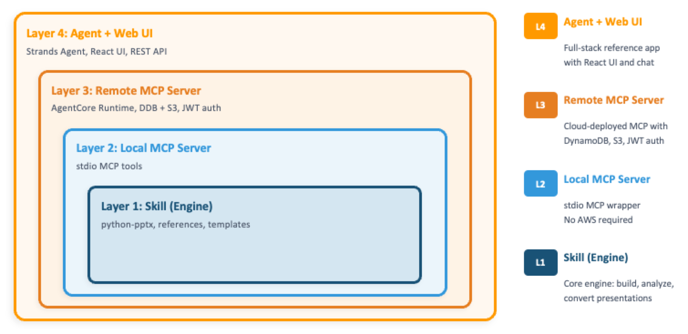
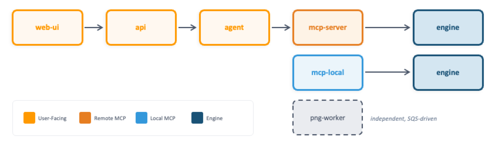
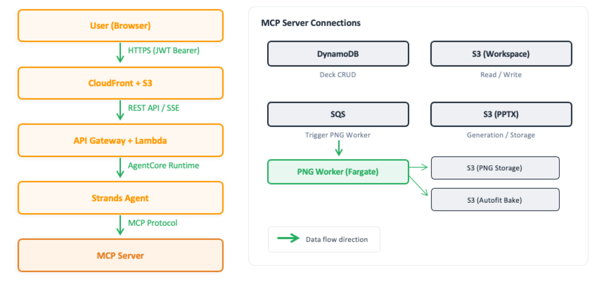
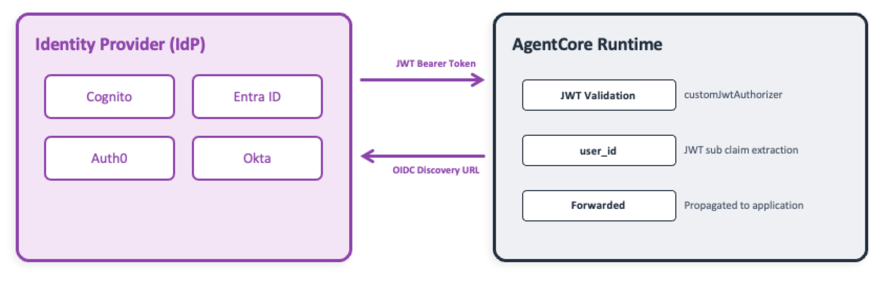
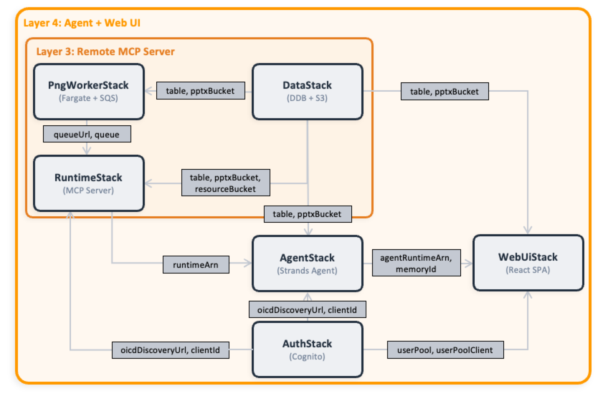

[EN](../en/architecture.md) | [JA (日本語ドキュメントは Getting Started のみ)](../ja/getting-started.md)

# Architecture

This document describes spec-driven-presentation-maker's overall architecture, data flow, authentication and authorization model,
data model, CDK stack structure, and deployment patterns.

---

## 4-Layer Architecture

spec-driven-presentation-maker consists of 4 layers.
Each layer is a thin wrapper around the previous one — use only the layers you need.



### Dependency Direction

Dependencies always flow top-down.



---

## Layer 1: Engine + Knowledge (`sdpm/`)

The core presentation engine. No network, no AWS, no MCP — just Python.

- **sdpm/sdpm/engine/** — json↔pptx conversion: builder, converter, layout engine, schema lint, preview, checks, diff, analyzer
- **sdpm/sdpm/engine/html/** — HTML output mode: converts a .pptx template to `theme.css` / `template.json` / decoration SVGs, assembles slide HTML files into a single offline `output.html` (vendored reveal.js under `sdpm/vendor/revealjs/`), and runs the static slide checks
- **sdpm/sdpm/knowledge/** — knowledge retrieval: references (guides/workflows/examples) and asset search
- **sdpm/sdpm/tools/** — the MCP tool contract: every tool's name, schema, docstring, and logic defined once; both servers register these functions directly
- **sdpm/references/** — workflows (role documents: orchestrator/composer/style/translate),
  spec (slide JSON schema), guides (design rules), examples (bundled styles)
- **sdpm/templates/** — Sample .pptx templates (dark/light)
- **sdpm/scripts/** — CLI entry point (`pptx_builder.py`), asset download scripts

Key capabilities:
- Analyze any .pptx template (layouts, colors, fonts, placeholders)
- Build slides from JSON with automatic layout optimization
- Generate PPTX files from `presentation.json`
- Convert existing PPTX back to JSON (via upload-time conversion)
- Multi-source asset search (AWS icons, Material Symbols, custom)

---

## Layer 2: Local MCP Server (`servers/local/`)

A thin bind of the `sdpm.tools` contract. Runs as a stdio server (plus an ACP variant for the local Web UI).

- Registers the contract tools via FastMCP — no tool logic of its own
- **Role entry tools `start_presentation` / `start_composing` / `start_style` / `start_translation`** — any MCP client (including ones with no skill/sub-agent mechanism, e.g. Claude Desktop) gets the role document as a tool response, together with what that role reads first (style/template catalogues; the deck's specs and assigned slides; a base style). The entry is carried by the tool surface itself, so nothing depends on skills, agent definitions or MCP Server Instructions (`SDPM_DISABLE_INSTRUCTIONS=1` turns the latter off).
- No AWS required — all files stored locally

---

## Layer 3: Remote MCP Server

The same `sdpm.tools` contract bound to an HTTP transport, with storage swapped to Amazon DynamoDB + S3 plus authentication and authorization. Bundled knowledge (references, templates) is baked into the container image; only user data (decks, uploads, user templates/styles) lives in S3/DynamoDB.

```
MCP Client → AgentCore Runtime → MCP Server Container
                                   ├── 20 MCP tools
                                   ├── LibreOffice (PPTX → PDF/SVG)
                                   ├── DynamoDB (decks, templates)
                                   ├── S3 (PPTX, previews, references, assets)
                                   └── Code Interpreter (optional)
```

Additional tools over Layer 2:
- `read_attachment` — Read content from an attached file (PDF, DOCX, XLSX, PPTX, text, images) with byte-offset paging
- `import_attachment` — Import attached files into the deck workspace
- `apply_style` — Apply a named style preset to a deck
- `run_python` — Execute Python in Amazon Bedrock AgentCore Code Interpreter sandbox (edit deck workspace, analyze data)
- `search_slides` — Semantic slide search via Amazon Bedrock Knowledge Base (optional)

HTML decks (`deck.json` `outputFormat: "html"`) use the same tools with these differences:

| Tool | HTML deck behaviour |
|------|---------------------|
| `init_deck_workspace` | `output_format="html"` creates an HTML deck (default `pptx`) |
| `start_composing` | `mode="html"` returns the HTML composer document, the template converted for HTML and the deck's `deck.css` |
| `run_python` | After a change to an HTML build input, rebuilds `output.html` and the changed slides' thumbnails and uploads them under `html/` |
| `generate_pptx` | Finalizes the deck as HTML: full build, every thumbnail, deck record update, knowledge-base sync (`search_slides` indexes HTML slides) |
| `get_preview` | Returns a note instead of images: HTML decks have no PNG previews; the Web UI shows the deck and its thumbnails |

The remote build reads and updates the deck record under the caller's user id, as the PPTX
build does. Only the deck owner's `run_python` / `generate_pptx` therefore rebuild an HTML
deck on S3; a collaborator's run reports `html_error` (`generate_pptx` returns an error)
and the published HTML stays as the owner last built it.
### Storage

```
DynamoDB:
  USER#{userId}/DECK#{deckId}       — deck metadata
  TEMPLATE#{id}/META                — template metadata

S3 (pptx bucket):
  decks/{deckId}/deck.json          — deck metadata (template, fonts, defaultTextColor)
  decks/{deckId}/slides/{slug}.json — per-slide data
  decks/{deckId}/specs/             — brief.md, outline.md, art-direction.html
  decks/{deckId}/includes/          — code block JSON
  decks/{deckId}/compose/           — per-slide SVG compose JSON (for Web UI animation)
  previews/{deckId}/{slideId}.png   — slide previews
  html/{deckId}/{uuid}.html         — HTML deck output.html (DynamoDB htmlS3Key)
  html/{deckId}/preview/{slug}_{epoch}.html — HTML slide thumbnails (latest epoch wins)
  template-html-cache/{cacheKey}/   — template HTML conversion (theme.css, template.json,
                                      layouts/*.svg); expires after 30 days

S3 (resource bucket):
  references/                       — examples, workflows, guides
  templates/                        — .pptx template files
  assets/                           — icons and images
```

### Deck Workspace

Using `run_python(deck_id=...)` loads the entire deck workspace into the sandbox.
The agent can read and write files using standard Python file I/O (`open`, `json.load`, etc.); modified files are written back to S3 automatically after every execution.

```
deck.json           — deck metadata (template, fonts, defaultTextColor, outputFormat)
slides/{slug}.json  — per-slide data (one file per slide, slug from outline)
slides/{slug}.html  — per-slide HTML fragment (HTML decks)
deck.css            — shared slide CSS (HTML decks)
specs/brief.md          — briefing (audience, purpose, key messages)
specs/outline.md        — one line per slide: - [slug] message
specs/art-direction.html — visual design direction (HTML style guide)
includes/           — code block JSON files
```

### Authentication

- JWT Bearer authentication via Amazon Bedrock AgentCore Runtime's `customJwtAuthorizer`
- Default is Amazon Cognito User Pool; supports any OIDC-compliant IdP
- User identity: JWT `sub` claim propagated through the entire stack
- Authorization: role-based per deck (owner / collaborator / viewer)

### Preview Generation

The MCP Server container includes LibreOffice and poppler-utils for synchronous preview generation.
When `generate_pptx` is called, previews are generated inline:

```
generate_pptx:
  1. Build PPTX from deck workspace (deck.json + slides/*.json)
  2. LibreOffice: PPTX → PDF
  3. pdftoppm: PDF → per-page PNG
  4. Pillow: PNG → WebP (quality=85)
  5. Upload WebP previews to S3
  6. LibreOffice: PPTX → SVG (for compose + text measurement)
  7. SVG → per-slide compose JSON (for Web UI animation)
```

The agent uses `get_preview` to retrieve preview images and visually review slides.

The compose pipeline (step 6–7) extracts optimized SVG components per slide and uploads them as JSON to S3. The Web UI uses these to render animated slide transitions without re-fetching full preview images.

Compose data and preview images follow the change, not the measure list: after `run_python`,
every slide the written files can alter is re-rendered — the edited `slides/<slug>.json`, slides
that reference a changed `includes/` file, slides that inherit from an affected one via
`override`, and every slide when `deck.json` or `specs/outline.md` changed
(`sdpm.engine.schema.affected_slugs`) — plus the `measure_slides` slugs.

### HTML Deck Security

An HTML deck runs scripts, so it is never served from the Web UI's origin:

- `output.html` carries a Content-Security-Policy `<meta>` that allows only the engine's own
  scripts (reveal.js, the notes plugin, the config and the speaker view), the bundled
  libraries a deck declares (ECharts, D3) and each slide's inline scripts, all by sha256
  hash computed at assembly, plus `data:` images, fonts and media; `connect-src` and
  `form-action` are `'none'`. A script added to `output.html` afterwards, a `<script src>`,
  an `on*` handler or a `javascript:` URL does not run. It also sets
  `<meta name="referrer" content="no-referrer">` so slide links do not leak the signed URL.
  Thumbnails carry a CSP without scripts.
- Slide scripts can still navigate or open tabs: no CSP directive stops that. The static
  checks warn on `location`, `window.open`, `top.` and external URLs in slide scripts
  (`script-external`), and the deck always plays in the sandboxed iframe described below.
- Locally, a deck with slide scripts is opened in headless Chrome or Edge after each build to
  collect JS errors, with networking disabled (proxy to a closed port, host resolution off,
  no non-proxied WebRTC) and a throwaway profile. It is skipped when no browser is found and
  in the cloud runtime image (`SDPM_JS_CHECK=0`); `SDPM_JS_CHECK=0` disables it locally too,
  and `SDPM_BROWSER` picks the executable (`none` disables). A check that is skipped or does
  not finish adds a one-line `output.html: JS check …` warning, and a slide that navigates
  the page away stops the check at once (the slide helper logs `pagehide`).
- HTML objects live under `html/` in the deck bucket. No CloudFront behaviour serves
  `html/*` and the CloudFront OAC bucket-policy grant does not include it.
- The API returns S3 presigned URLs on the bucket's regional host (a different origin from
  the Web UI), with `text/html; charset=utf-8`: the in-app view and thumbnails for 900 s in
  `GET /decks/{id}`, and `GET /decks/{id}/html?purpose=present` (14400 s, inline) or
  `purpose=download` (900 s, attachment). Both go through the deck's `read` authorization.
- The Web UI plays the deck in an iframe with `sandbox="allow-scripts allow-popups
  allow-popups-to-escape-sandbox"` (no `allow-same-origin`, so it gets an opaque origin; no
  `allow-top-navigation`) and renders thumbnails in `sandbox=""` iframes. The engine gives
  every external link `target="_blank" rel="noopener noreferrer"`; the escape token lets
  the linked site load normally in its new tab, while the deck stays sandboxed. Present
  opens a new tab with `opener` cleared.
- The local Web UI serves `output.html` with `Content-Security-Policy: sandbox allow-scripts
  allow-popups allow-popups-to-escape-sandbox` and thumbnails with
  `Content-Security-Policy: sandbox`, both `nosniff`.

### Text Measurement

The `run_python(measure_slides=[...])` parameter triggers LibreOffice SVG export to measure text bounding boxes,
enabling overflow detection during the Build loop without visual review. Measurement (overflow,
layout bias, invalid layouts) covers only those slugs.

---

## Layer 4: Agent + Web UI

A reference implementation of a full-stack application.

- **Agent** — Strands Agent on Amazon Bedrock AgentCore Runtime, connects to Layer 3 MCP Server. Includes built-in tools: `web_fetch` (URL → Markdown, supports HTML/PDF/images)
- **Web UI** — React + Tailwind CSS + shadcn/ui, deployed via S3 + Amazon CloudFront. Features animated slide preview via SVG compose pipeline
- **API** — Lambda-backed REST API (deck CRUD, file upload, chat history)
- **Auth** — Amazon Cognito User Pool with hosted UI

The agent's system prompt is minimal — workflow knowledge is dynamically retrieved from MCP Server Instructions, making the MCP Server the single source of truth.

---

## Data Flow

### Layer 4 (Full Stack) Data Flow




### Slide Generation Steps

1. User describes the presentation content via chat
2. Agent calls MCP Server tools to create a deck (`init_deck_workspace`)
3. Analyzes the template and retrieves available layouts (`analyze_template`)
4. Following workflow files, designs briefing → art direction → outline (persisted to `specs/`)
5. Builds slides (`run_python` to edit files in the workspace)
6. Generates PPTX (`generate_pptx`) → saved to S3, previews generated synchronously
7. Retrieves preview images for review (`get_preview`)

---

## Authentication and Authorization Model

### JWT Bearer Authentication

spec-driven-presentation-maker integrates with any OIDC-compliant IdP (Identity Provider).



- Amazon Bedrock AgentCore Runtime's `customJwtAuthorizer` validates the JWT
- The JWT `sub` claim is propagated as `user_id` to the application
- By default, CDK creates an Amazon Cognito User Pool (for demo/quick start)
- For external IdPs, set `oidcDiscoveryUrl` and `allowedClients` in `config.yaml`

### Authorization (Role-Based Access Control)

Access is controlled per deck (presentation).

#### Role Resolution Priority

```
1. Is the user the deck creator?     → owner
2. Is there a sharing record?        → collaborator
3. Is the deck set to public?        → viewer
4. None of the above                 → none (access denied)
```

#### Permission Matrix

| Action | owner | collaborator | viewer | none |
|---|:---:|:---:|:---:|:---:|
| read (view deck info) | ✅ | ✅ | ✅ | — |
| preview (get preview images) | ✅ | ✅ | ✅ | — |
| edit_slide (edit slides) | ✅ | ✅ | — | — |
| generate_pptx (generate PPTX) | ✅ | ✅ | — | — |
| update (update deck info) | ✅ | — | — | — |
| delete_deck (delete deck) | ✅ | — | — | — |
| change_visibility (change public setting) | ✅ | — | — | — |

Authorization logic is centralized in `shared/authz.py`, used by both the API and MCP Server.
To add custom roles (e.g., team-based access), modify the `resolve_role` function.

---

## MCP Tool Reference

### Layer 2 Tools

| Category | Tool | Description |
|----------|------|-------------|
| Prompts | `sdpm-vibe`, `sdpm-spec`, `sdpm-style`, `sdpm-translate` | User-invoked (slash-command) entry points; `vibe` / `spec` set the interaction mode |
| Entry | `start_presentation`, `start_composing`, `start_style`, `start_translation` | Role document + what the role reads first (orchestrator, composer, style, translate). `start_composing(mode="pptx"\|"html")` picks the composer document for the deck's output format |
| Workflow | `init_deck_workspace`, `check_specs`, `apply_style`, `analyze_template` | Create deck workspace (`output_format="pptx"\|"html"`), validate specs, apply style, analyze template |
| Generation | `generate_pptx`, `get_preview` | Generate PPTX, get preview (local `generate_pptx` refuses HTML decks; `run_python` builds them) |
| Assets | `search_assets`, `list_templates` | Search icons (empty query = discovery), list templates |
| References | `list_styles` | Bundled and user styles |
| References | `read_guides` | Design rules, guides, and the slide JSON spec (`slide-json-spec`) |
| Layout | `grid` | CSS Grid coordinate calculation |
| Utility | `code_to_slide` | Code highlighting |

### Layer 3 Additional Tools

| Tool | Description |
|------|-------------|
| `read_attachment` | Read content from an attached file with byte-offset paging |
| `import_attachment` | Import attached files into the deck workspace |
| `apply_style` | Apply a named style preset to a deck |
| `run_python` | Execute Python in Code Interpreter sandbox |
| `search_slides` | Semantic slide search (optional, requires Amazon Bedrock KB) |

### Agent-Level Tools (Layer 4)

| Tool | Description |
|------|-------------|
| `web_fetch` | Fetch a URL and convert to Markdown (supports HTML, PDF, images) |

### Tool Surface Design Notes

Deliberate asymmetries between surfaces — these are design decisions, not gaps:

- **`hearing` is ACP-only (Local) / agent-level (Cloud).** Interactive hearing
  depends on a client-side UI (the ACP session prompt on Local, the Strands
  agent loop on Cloud). Plain MCP has no interaction channel, so `hearing` is
  intentionally not part of the `sdpm.tools` contract — it is a
  transport-specific addition, which the local server is allowed to carry.
- **ACP agents load fixed-role workflows directly.** Each canonical definition in `servers/local/.kiro/acp-agents/` points its `prompt` at `file://../../../../sdpm/references/workflows/<role>.md`, so the role is fixed without embedding or fetching a second copy.
- **The CLI surface is kept even where MCP tools overlap.** The CLI +
  `sdpm/SKILL.md` form the no-MCP adapter (Layer 1). CLI subcommands cost no
  MCP schema tokens and are the only operability for agents without MCP
  support, so overlap with MCP tools is acceptable — they are two adapters
  over the same engine.
- **HTML output mode adds no MCP tool.** `run_python` rebuilds `output.html`
  through `sdpm.api.refresh_html` after every change to an HTML deck, the CLI
  has `generate_html` for the no-MCP path, and on the remote server
  `generate_pptx` finalizes an HTML deck as HTML (see Layer 3).
- **`search_slides` redesign is deferred.** The KB-backed search tool is kept
  as-is on Layer 3; rethinking it (scope, index lifecycle) is a separate
  theme, tracked outside the attachment/tool-cleanup work.

---

## CDK Stack Structure

### Stack Dependencies



### Stack Roles

| Stack | Resources | config.yaml Key |
|---|---|---|
| SdpmData | Amazon DynamoDB table, S3 buckets ×2, reference deployment | `stacks.data` |
| SdpmRuntime | Amazon Bedrock AgentCore Runtime + ECR | `stacks.runtime` |
| SdpmAgent | Strands Agent (Amazon Bedrock AgentCore Runtime) | `stacks.agent` |
| SdpmWebUi | S3 + Amazon CloudFront + Amazon API Gateway + Lambda | `stacks.webUi` |
| SdpmAuth | Amazon Cognito User Pool (auto-created when agent or webUi enabled) | (auto) |
| SdpmCloudFrontWaf | AWS WAF WebACL for CloudFront (us-east-1) | `waf.*` |

---

## Deployment Patterns

Select which stacks to enable in `config.yaml` for incremental deployment.

### Pattern 1: Layer 3 Only (MCP Server)

Minimum deployment. Connect directly from MCP clients.

### Pattern 2: Layer 3 + PNG Preview

Enables agents to visually review slides.

### Pattern 3: Full Stack (Layer 4)

Complete deployment including Web UI. Create slides via browser chat.

For `config.yaml` examples and deployment instructions, see [Getting Started — Layer 3](getting-started.md#layer-3-remote-mcp-server-aws).

---

## Related Documents

- [Getting Started](getting-started.md) — Setup and deployment instructions
- [Custom Templates](custom-template.md) — Adding templates and assets
- [Connecting Agents](add-to-gateway.md) — MCP client connection guide
