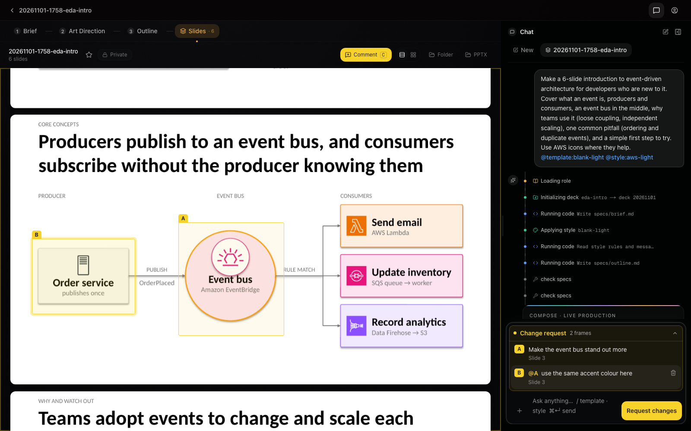

[English](getting-started.md) | [日本語](../ja/getting-started.md)

# Getting Started

There are three ways to use SDPM:

- from **your own AI agent** (Claude Code, Kiro CLI, Cursor, VS Code, Codex, Claude Desktop) through MCP
- in **your browser**, with the Web UI running on your computer
- on **a team server on AWS**

This guide covers the first two. Both run on your computer and need no AWS account. For the
AWS server, see the [Deploy guide](deploy-cloudshell.md). To work on the code itself, see the
[Developer guide](developer-guide.md).

## Install

One command installs SDPM into `~/.sdpm`. It sets up a git checkout, the MCP server
environment, the icon catalogs and the `sdpm` launcher. The same checkout serves your AI
agent and, if you want it, the browser Web UI. There is one thing to update and one thing
to remove.

```bash
# macOS / Linux
curl -fsSL https://raw.githubusercontent.com/aws-samples/sample-spec-driven-presentation-maker/main/scripts/install/dist/install.sh | bash
```

```powershell
# Windows (PowerShell 5.1 or 7; verified in CI only)
irm https://raw.githubusercontent.com/aws-samples/sample-spec-driven-presentation-maker/main/scripts/install/dist/install.ps1 | iex
```

What happens:

1. The installer checks for `git` and `uv` and offers to install what is missing. It also
   offers LibreOffice and poppler, which slide previews need. Previews are optional: a deck
   builds without them.
2. **What to install** is a checklist with two rows: the MCP server (always on) and the
   browser Web UI (ticked by default; press space to untick). With the Web UI, the installer
   also installs Node.js 20+ and Kiro CLI (the Web UI's agent backend) and builds the UI.
   Without it, nothing needs Node.js.
3. The checkout is cloned to `~/.sdpm/checkout`, the server environment is synced, and the
   AWS and Material icon catalogs are downloaded.
4. **Connect SDPM to your MCP clients** is a checklist of the clients found on the machine,
   all ticked. Untick what you do not want (space) and confirm (enter). A result table
   follows: ✓ registered, – skipped (with the `sdpm register <client>` command to do it
   later), ✗ failed. Nothing is written for an unticked client.

Running the installer again repairs an existing installation. It never creates a second one.
It keeps that installation's profile and Kiro agent name (unless you pass `--full`,
`--mcp-only` or `--agent-name`), and instead of the client checklist it registers SDPM
again with the clients that already have it, as `sdpm update` does; `--register` also adds
the detected clients that do not.

### Installer options

| Option | Effect |
|---|---|
| `--full` / `--mcp-only` | Skip the profile question |
| `--register` / `--no-register` | Register with every detected client / only print the configuration |
| `--agent-name NAME` | Name of the Kiro CLI agent (default `sdpm`; remembered for `sdpm register` / status) |
| `--non-interactive` | Accept all prompts (profile defaults to full) |
| `--skip-libreoffice`, `--skip-shortcut` | Leave those out |
| `--deps-only` | Install `git`, `uv`, LibreOffice and poppler only (for a developer checkout) |

Environment equivalents: `SDPM_PROFILE=full|mcp`, `SDPM_REGISTER=yes|no`,
`SDPM_NON_INTERACTIVE=1`, `SDPM_HOME` (install root, default `~/.sdpm`),
`SDPM_LAUNCHER_DIR` (default `~/.local/bin`; `%USERPROFILE%\bin` on Windows).
`bash -s -- --mcp-only` passes options through `curl … | bash`.

### Non-interactive install (scripts and AI agents)

Many people hand this repository's URL to a coding agent and ask it to install SDPM. The
form without questions is:

```bash
curl -fsSL https://raw.githubusercontent.com/aws-samples/sample-spec-driven-presentation-maker/main/scripts/install/dist/install.sh | bash -s -- --mcp-only --non-interactive --register
```

- `--mcp-only` skips the browser Web UI. Drop it, or use `--full`, to include the Web UI
  (needs Node.js 20+).
- `--register` connects every MCP client found on the machine without asking.
  `--no-register` prints the configuration instead.

Then check the result. `sdpm` prints the status, and
`python3 ~/.sdpm/checkout/scripts/install/mcp_smoke.py ~/.local/bin/sdpm mcp` prints
`OK: … 20 tools` when the MCP server answers.

## The `sdpm` launcher

```
sdpm                    status: version, profile, surfaces, which clients are connected
sdpm webui              start the browser Web UI and open it
sdpm mcp                run the MCP server on stdio (to check it from a terminal)
sdpm register [CLIENT]  connect MCP clients (checklist of detected clients; --yes, --dry-run)
sdpm unregister         disconnect them again
sdpm mcp-config [CLIENT]  print the client configuration with this machine's paths (--json, --all)
sdpm update [--with-webui]  pull main, sync, rebuild what is installed (or add the Web UI), refresh
                        this command and the registered clients (see Update and uninstall)
sdpm doctor             environment checks
sdpm uninstall          remove ~/.sdpm, the launcher, shortcuts; offers to unregister
```

The launcher is the same on every OS. It lives in `~/.local/bin` on macOS and Linux. If
that directory is not on your `PATH`, the installer says so at the end: add it to your
shell's `PATH` and open a new terminal. On Windows the launcher goes into
`%USERPROFILE%\bin`, which the installer adds to your user `PATH`; open a new terminal to
pick it up. `sdpm mcp` is for checking the server by hand. The configuration that clients
receive points at `uv` and the checkout directly (next section), so clients do not need the
launcher on `PATH`.

## Your AI agent (MCP)

MCP (Model Context Protocol) is the protocol AI agents use to call tools. SDPM is an MCP
server, so any agent that supports MCP can make slides with it.

`sdpm register` connects the server through each client's own CLI. For Kiro CLI, it creates
an agent file that SDPM owns. You do not edit any existing configuration file by hand.

| Client | What `sdpm register` does |
|---|---|
| Kiro CLI | Writes a dedicated agent `~/.kiro/agents/sdpm.json` (MCP server, tools, trusted `@sdpm` and `use_subagent` for parallel composers, no prompt text). Both Kiro CLI engines (V2 and V3) load the file as-is. Start it with `kiro-cli chat --agent sdpm` or `/agent sdpm`; in V3, another agent that delegates to `sdpm` asks you to approve each sdpm tool. Nothing is added to other sessions. `--agent-name` picks another name. An agent file you wrote yourself is never touched, and in the file SDPM writes, what other tools added (other MCP servers, their tools and settings) is kept |
| Claude Code | `claude mcp add --scope user sdpm -- …`. Composers run as Claude Code sub-agents, which inherit the server. Approve the sdpm tools once ("don't ask again"), or launch with `claude --allowedTools "mcp__sdpm__*"`. If the old plugin `sdpm@sdpm` is still installed, `sdpm register` offers `claude plugin uninstall`; otherwise every tool appears twice |
| Visual Studio Code | `code --add-mcp …` |
| Codex (CLI, IDE extension, ChatGPT desktop app) | `codex mcp add sdpm -- …` |
| Cursor | Opens the `cursor://…/mcp/install` deep link built with your real paths: one click. Clients without sub-agents compose the slides in one agent, one group at a time |
| Kiro IDE, other clients | Prints the JSON and the file it belongs in (`~/.kiro/settings/mcp.json` for Kiro IDE) |
| Claude Desktop | Use the [`sdpm.mcpb`](https://github.com/aws-samples/sample-spec-driven-presentation-maker/releases/latest/download/sdpm.mcpb) release bundle instead (double-click it) |

Every configuration is the same entry, with absolute paths:

```json
{
  "mcpServers": {
    "sdpm": {
      "command": "/Users/you/.local/bin/uv",
      "args": ["run", "--directory", "/Users/you/.sdpm/checkout/servers/local", "--frozen", "python", "server.py"]
    }
  }
}
```

Absolute paths matter because GUI clients started from the Dock or the Start Menu do not
inherit your shell `PATH`. For Kiro CLI, the same block sits inside the agent file.
`sdpm mcp-config` prints this block with your paths filled in, so a client that is not
listed above can take it as is.

If you used SDPM before the installer existed, see the [migration guides](migration/README.md).

### Your first request

Ask your agent for slides, for example "Make a 6-slide introduction to event-driven
architecture for new developers". You can attach files or paste URLs as the source material.
The agent first writes the spec (brief, style, outline), then builds the slides. Nothing
else needs setting up.

To choose how the agent works, use the server's prompts where your client shows them:

| Prompt | What it does |
|---|---|
| `sdpm-vibe` | **Fast path**: builds the deck from your material without asking questions |
| `sdpm-spec` | **Review path**: shapes the deck with you in conversation first |
| `sdpm-style` | Creates a reusable style (colours, fonts, how slides look) |
| `sdpm-translate` | Makes a copy of a PPTX deck in another language |

How each client shows them: Claude Desktop in the "+" menu, Claude Code as
`/mcp__sdpm__sdpm-vibe`, VS Code as `/mcp.sdpm.sdpm-vibe`, Kiro CLI as `/sdpm-vibe`.

Slide previews need LibreOffice and poppler. Without them the deck still builds. The build
result then carries `preview: {"status": "unavailable", "install": "…"}` with the install
command for your OS, and the agent tells you. If the icon catalogs are missing for any
reason, the server downloads them in the background on its first start.

## Your browser (Web UI)

`sdpm webui` starts the Web UI in Local mode and opens it. Local mode is a Next.js app on
`http://localhost:3000` that talks to Kiro CLI over ACP (Agent Client Protocol, which lets an
app drive an AI agent). Run `kiro-cli login` once before the first use. It signs you in to
Kiro with GitHub, Google, an AWS Builder ID or your organization's IAM Identity Center; no
AWS account is needed, and Kiro has a free plan ([Kiro pricing](https://kiro.dev/pricing/)).
The installer also
creates a desktop shortcut. If you installed only the MCP server, add the Web UI later with
`sdpm update --with-webui`. Details: [Web UI Local mode](../../web-ui/README.md#local-mode).

### What you can do in the Web UI

- **Choose how to work.** On the first chat screen, pick **Fast path** (a first draft from
  your material, no questions) or **Review path** (agree on the story with the agent before
  any slide is built).
- **Give it material.** Attach up to 5 files at a time from the **+** menu (PDF, DOCX, XLSX,
  PPTX, text files and images), or paste URLs into the message.
- **Pick a template, style or format.** Type `/` in the message to choose a template, a
  style, or the HTML format.
- **Follow the spec.** The deck page has a tab for each part of the spec: **Brief**,
  **Outline**, **Art Direction** (the style), and **Slides**.
- **Comment on the slides.** See [Comments on the slides](#comments-on-the-slides) below.
- **Manage styles.** The **Styles** page shows the built-in styles and your own. You can
  create or edit a style with AI (**Create with AI**, **Edit with AI**), copy a built-in
  style to your styles, and import or export style files.
- **Manage templates.** The **Templates** page lists the built-in templates and lets you
  upload your own `.pptx`, with an optional note on when to use it.
- **Continue from a Kiro CLI session.** Start a deck from an earlier `kiro-cli` chat on this
  computer ([details](../../web-ui/README.md#continue-from-a-kiro-cli-session)).

Local mode keeps decks in `~/Documents/SDPM-Presentations`. Set `SDPM_DECK_ROOT` to use
another folder.

### Comments on the slides

You can mark what to change directly on the slides and send it as one change request.

1. Open a deck and turn on the **Comment** tool in the preview header (or press `C`).
2. Drag to outline an area, or click to place a frame. Each frame gets a letter (A, B, …).
3. Write what should change. Type `@A` to refer to another frame.
4. The frames collect above the chat input. Press **Request changes** to send them,
   together with anything you typed in the input.

The agent sends one composer per slide to make the changes and replies to each comment.
The Comment tool is available on desktop only, in Local mode and on the AWS stack.



## HTML decks

Ask for an HTML, browser or reveal.js deck (or put `@format:html` in the message), and the
agent builds a browser presentation instead of a PPTX. It uses the same templates and
styles. The result is `<deck>/output.html`, a single file that works offline. In the
browser, press `S` for the speaker view with notes, `F` for full screen and `Esc` for the
slide overview. To get a PDF, open `output.html?print-pdf` and print from the browser.

- A template is converted for HTML on first use and cached. Carrying over its decorations
  (logos, bands, background art) needs LibreOffice and poppler. Without them the layouts
  and placeholders still convert. Templates without decorations, such as the bundled ones,
  need neither.
- If Chrome or Edge is installed, each `run_python` that changes slides opens them in a
  headless browser. Layout problems (overlap, overflow, content outside its region or over
  template decorations) and JavaScript errors come back as warnings, and each checked slide
  gets a PNG preview (`<deck>/preview/png/<slug>.png`, returned as `preview_files`).
  Without a browser, the check is skipped with a one-line warning. `SDPM_BROWSER` picks the
  browser executable (`none` turns the check off). The local server also writes a static
  thumbnail per slide (`<deck>/preview/<slug>.html`) next to `output.html`.
- PPTX-only features (translation, PPTX import, hand-edit sync) refuse HTML decks.
- Slides can run JavaScript. Apache ECharts and D3 are bundled and embedded only in decks
  that use them.

### HTML decks in the Web UI

On the first chat screen, turn on **Build as HTML** (under **Fast path** / **Review path**)
before sending, or type `/` and pick **HTML** under **Format**. Both put `@format:html` in
the message, shown as an "HTML" chip you can remove. Without it the deck is a PPTX.

The deck page of an HTML deck shows an "HTML" badge and plays the deck in the page. The
slide grid shows a static thumbnail of each slide. In the local Web UI, the header has one
**Open** button, which opens `output.html` in your default browser.

On the AWS stack, the header has three buttons:

- **Present** opens the deck in a new tab. Press `S` there for the speaker view with notes.
  It works only in that tab, not in the in-app player. The link is valid for 4 hours, and
  the speaker view reloads it when it opens, so press `S` early in a talk.
- **PDF** opens the print view in a new tab. Print it from the browser to save a PDF.
- **HTML** (download icon) saves the single `output.html`, which works offline.

Public decks work as PPTX decks do: anyone who can view the deck can present and download it.

## Update and uninstall

- `sdpm update` pulls the latest `main` and rebuilds what is installed.
  `sdpm update --with-webui` also adds the Web UI to an MCP-only install.
  Changes to tracked files in `~/.sdpm/checkout` (tools of earlier versions rewrote some)
  are moved to a git stash before the pull, never discarded: the update lists the files and
  prints the `git stash apply` command that brings them back.
  It then brings the rest of the install up to date:
  - replaces the `sdpm` command with the new version
  - registers SDPM again with the clients that already have it (the Kiro CLI agent under
    the name chosen at install, Claude Code, Codex). It adds no client: clients it finds
    without SDPM are named, and `sdpm register` adds them. VS Code and Cursor cannot report
    whether they have SDPM, so they are left as they are, and so is a Claude Code or Codex
    `sdpm` server that runs another checkout (`make register-dev`)
  - removes what earlier versions left and nothing uses (`servers/local/.venv`,
    `sdpm/.venv`, the old Kiro installer's files)
  - prints what to do after this update, from the CHANGELOG's Upgrading notes for local
    installs, when there is anything

  An install made before this behaviour has a `sdpm` command that does not replace itself;
  its first `sdpm update` does the same once. If you installed with `SDPM_LAUNCHER_DIR`
  and that directory is not on `PATH`, set it again for that update.
- `sdpm uninstall` removes `~/.sdpm`, the launcher and the shortcuts, and offers to
  disconnect your MCP clients.

To remove a deployment from your AWS account, see [Uninstall (AWS)](uninstall.md).

## Troubleshooting

### `sdpm update` stops

An install whose `sdpm` command comes from before 0.13.0 can stop at the pull:

```
error: Your local changes to the following files would be overwritten by merge:
        sdpm/uv.lock
Please commit your changes or stash them before you merge.
Aborting
SDPM update failed while Fast-forwarding main (exit 1).
```

The files are ones that version's tools rewrote (`sdpm/uv.lock` by uv,
`web-ui/next-env.d.ts` by the Web UI build). The pull stops before any new code runs, so
that update cannot get past it by itself. Run the installer again: it moves the changes to a
git stash, updates, and keeps your profile, agent name and registered clients.

```bash
curl -fsSL https://raw.githubusercontent.com/aws-samples/sample-spec-driven-presentation-maker/main/scripts/install/dist/install.sh | bash
```

```powershell
irm https://raw.githubusercontent.com/aws-samples/sample-spec-driven-presentation-maker/main/scripts/install/dist/install.ps1 | iex
```

Or move the changes aside yourself and update again (the `-c` options give the stash an
author on a machine where git has none):

```bash
git -C ~/.sdpm/checkout -c user.name=sdpm -c user.email=sdpm@localhost stash && sdpm update
```

```powershell
git -C $HOME\.sdpm\checkout -c user.name=sdpm -c user.email=sdpm@localhost stash; sdpm update
```

Nothing is discarded either way; `git -C ~/.sdpm/checkout stash list` shows what was set
aside. From 0.13.0 on, `sdpm update` sets such changes aside by itself. If it still stops
("could not fast-forward main"), the checkout has commits of its own or an untracked file
where `main` now has one; git's message above names them, and nothing was discarded.

## Next steps

- [Custom templates, styles and assets](custom-template.md): use your own `.pptx`, styles and icons
- [Deploy guide](deploy-cloudshell.md): run SDPM on AWS for a team (One-Click Deploy, no local CDK or Docker)
- [Developer guide](developer-guide.md): work from a checkout, deploy with CDK
- [Architecture](architecture.md): how the parts fit together
