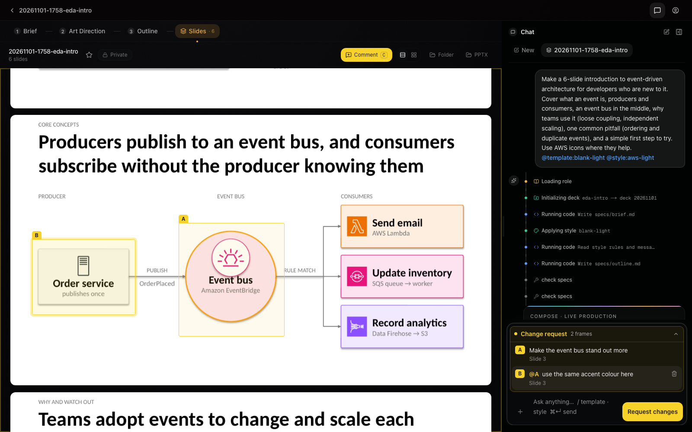

[English](../en/getting-started.md) | [日本語](getting-started.md)

# はじめに

SDPM の使い方は 3 つあります。

- MCP 経由で **いつもの AI エージェント**（Claude Code、Kiro CLI、Cursor、VS Code、Codex、Claude Desktop）から使う
- 手元のコンピューターで動かす Web UI を **ブラウザ** で使う
- **AWS 上のチームサーバー** で使う

このガイドでは最初の 2 つを説明します。どちらも手元で動き、AWS アカウントは不要です。AWS 上のサーバーは
[デプロイガイド](../en/deploy-cloudshell.md)（英語）、コードを変更する場合は
[開発者ガイド](../en/developer-guide.md)（英語）を参照してください。

## インストール

1 コマンドで SDPM の最新のリリースが `~/.sdpm` に入ります。git checkout、MCP サーバーの環境、アイコンカタログ、
`sdpm` ランチャーをまとめて用意します。同じ checkout が AI エージェントと、必要ならブラウザ用の
Web UI の両方に使われるので、更新するものも削除するものも 1 つです。

```bash
# macOS / Linux
curl -fsSL https://raw.githubusercontent.com/aws-samples/sample-spec-driven-presentation-maker/main/scripts/install/dist/install.sh | bash
```

```powershell
# Windows（PowerShell 5.1 / 7。CI での検証のみ）
irm https://raw.githubusercontent.com/aws-samples/sample-spec-driven-presentation-maker/main/scripts/install/dist/install.ps1 | iex
```

流れ:

1. `git` と `uv` があるかを確認し、無ければ導入を提案します。スライドのプレビューに使う
   LibreOffice と poppler も提案します。プレビューは任意で、無くてもデッキは作れます。
2. **What to install** は 2 行のチェックリストです。MCP サーバー（常にオン）とブラウザ用 Web UI
   （既定でオン。space で外す）。Web UI を含めると、Node.js 20+ と Kiro CLI（Web UI のエージェント
   基盤）も入れて UI をビルドします。外せば Node.js は不要です。
3. `~/.sdpm/checkout` に clone し、最新のリリース（いちばん新しい `vX.Y.Z` のタグ。`--channel main`
   なら `main` の先端）にそろえます。サーバーの環境を同期し、AWS と Material のアイコンカタログを取得します。
4. **Connect SDPM to your MCP clients** は、マシン上で見つかったクライアントのチェックリストです
   （すべてオン）。不要なものを space で外し、enter で確定します。続けて結果が表で出ます:
   ✓ registered、– skipped（後で接続するための `sdpm register <client>` 付き）、✗ failed。
   外したクライアントには何も書き込みません。

インストーラーをもう一度実行すると、既存のインストールを修復します。2 つ目は作りません。
そのインストールのプロファイル、Kiro エージェントの名前、追う先を引き継ぎ（`--full`、`--mcp-only`、
`--agent-name`、`--channel` を渡した場合を除く）、`sdpm update` と同じく更新します。クライアントの
チェックリストの代わりに、SDPM が登録済みのクライアントに登録し直します。`--register` を付けると、
未登録の検出済みクライアントにも登録します。

インストールと update のたびに、OS と用途に合ったリリースのマニフェストを 1 つダウンロードします。その回数は GitHub が数え、ほかには何も送りません。

### インストーラーのオプション

| オプション | 効果 |
|---|---|
| `--full` / `--mcp-only` | プロファイルの質問を省く |
| `--register` / `--no-register` | 検出した全クライアントに登録 / 設定を表示するだけ |
| `--agent-name NAME` | Kiro CLI エージェントの名前（既定 `sdpm`。`sdpm register` と状態表示でも使われる） |
| `--channel release\|main` | 最新のリリースを追う（既定）か、`main` にマージされた変更をすべて追うか。`sdpm update` も引き継ぐ |
| `--non-interactive` | すべての質問に yes（プロファイルは full）。端末が無いときは自動でこの動作になる |
| `--skip-libreoffice`, `--skip-shortcut` | それらを省く |
| `--deps-only` | `git`・`uv`・LibreOffice・poppler だけを入れる（開発者の checkout 向け） |

環境変数版: `SDPM_PROFILE=full|mcp`、`SDPM_REGISTER=yes|no`、`SDPM_CHANNEL=release|main`、
`SDPM_AGENT_NAME`、`SDPM_NON_INTERACTIVE=1`、
`SDPM_HOME`（インストール先、既定 `~/.sdpm`）、`SDPM_LAUNCHER_DIR`（既定 `~/.local/bin`、Windows は
`%USERPROFILE%\bin`）。`curl … | bash -s -- --mcp-only` のようにしてオプションを渡せます。

### 非対話のインストール（スクリプトと AI エージェント向け）

このリポジトリの URL をコーディングエージェントに渡して、インストールを頼む人も多いはずです。
質問なしで実行する形は次のとおりです。

```bash
curl -fsSL https://raw.githubusercontent.com/aws-samples/sample-spec-driven-presentation-maker/main/scripts/install/dist/install.sh | bash -s -- --mcp-only --non-interactive --register
```

- `--mcp-only` はブラウザ用 Web UI を省きます。Web UI も入れるなら外すか `--full` を使います
  （Node.js 20+ が必要）。
- `--register` は見つかった全 MCP クライアントに確認なしで接続します。`--no-register` なら設定を
  表示するだけです。
- 端末が無いときは入力を待ちません。`--non-interactive` と同じ動作になります。sudo のパスワードが
  要る場面（Linux の apt、macOS の Homebrew）では、人が打つコマンドを表示して 1 で終わります。

終わったら結果を確認します。`sdpm` が状態を表示し、
`python3 ~/.sdpm/checkout/scripts/install/mcp_smoke.py ~/.local/bin/sdpm mcp` は MCP サーバーが
応答すれば `OK: … 20 tools` と表示します。

## `sdpm` ランチャー

```
sdpm                    状態: 版、追う先、プロファイル、入っている面、接続済みクライアント
sdpm webui              ブラウザ用 Web UI を起動して開く
sdpm open DECK          デッキ（フォルダーか名前）をブラウザ用 Web UI で開く（動いていなければ起動）
sdpm mcp                MCP サーバーを stdio で起動（ターミナルでの動作確認用）
sdpm register [CLIENT]  MCP クライアントに接続（検出クライアントのチェックリスト。--yes, --dry-run）
sdpm unregister         接続を解除
sdpm mcp-config [CLIENT]  このマシンのパス入りでクライアント設定を表示（--json, --all）
sdpm update [--with-webui] [--channel release|main]
                        最新のリリース（または main）に移り、同期して入っているものを再ビルド
                        （Web UI の追加も）。このコマンドと登録済みクライアントもそろえる
                        （「更新とアンインストール」）
sdpm doctor             環境チェック
sdpm uninstall          ~/.sdpm・ランチャー・ショートカットを削除。登録解除も提案
```

ランチャーは全 OS で同じです。macOS と Linux では `~/.local/bin` に入ります。このディレクトリが `PATH` に
無い場合はインストーラーが最後にそう表示するので、シェルの `PATH` に追加して新しいターミナルを開いて
ください。Windows では `%USERPROFILE%\bin` に入り、インストーラーがユーザーの `PATH` に追加します。新しい
ターミナルを開くと使えます。`sdpm mcp` は手でサーバーを確認するためのものです。クライアントに渡す
設定は `uv` と checkout を直接指す（次節）ので、クライアント側でランチャーが `PATH` にある必要はありません。

## AI エージェントから使う（MCP）

MCP（Model Context Protocol）は、AI エージェントがツールを呼び出すためのプロトコルです。SDPM は
MCP サーバーなので、MCP に対応したエージェントならどれでもスライドを作れます。

`sdpm register` は各クライアント自身の CLI で接続します。Kiro CLI には SDPM が所有するエージェント
ファイルを作ります。既存の設定ファイルを手で編集する必要はありません。

| クライアント | `sdpm register` がすること |
|---|---|
| Kiro CLI | 専用エージェント `~/.kiro/agents/sdpm.json` を書き込みます（MCP サーバー、ツール、並列コンポーザーのための `@sdpm` と `use_subagent` の信頼設定。prompt テキストは無し）。Kiro CLI の V2 と V3 のどちらも、このファイルをそのまま読み込みます。`kiro-cli chat --agent sdpm` か `/agent sdpm` で開始します。V3 では、別のエージェントから `sdpm` に委譲すると、sdpm のツールごとに承認を求められます。他のセッションには何も足しません。`--agent-name` で別名にできます。自分で書いたエージェントファイルには触れません。SDPM が書くファイルでも、ほかのツールが足した設定（ほかの MCP サーバー、そのツールと設定）は残します |
| Claude Code | `claude mcp add --scope user sdpm -- …`。コンポーザーは Claude Code のサブエージェントとして動き、サーバーを引き継ぎます。sdpm ツールを 1 度承認する（「今後確認しない」）か、`claude --allowedTools "mcp__sdpm__*"` で起動します。旧 plugin `sdpm@sdpm` が残っていれば `sdpm register` が `claude plugin uninstall` を提案します。残すと全ツールが二重に見えます |
| Visual Studio Code | `code --add-mcp …` |
| Codex（CLI / IDE 拡張 / ChatGPT デスクトップアプリ） | `codex mcp add sdpm -- …` |
| Cursor | 実際のパスで組み立てた `cursor://…/mcp/install` のディープリンクを開きます。1 クリックで完了です。サブエージェントの無いクライアントでは、1 つのエージェントがグループごとに順にスライドを作ります |
| Kiro IDE、その他 | JSON と、それを書き込むファイルを表示します（Kiro IDE は `~/.kiro/settings/mcp.json`） |
| Claude Desktop | 代わりにリリースの [`sdpm.mcpb`](https://github.com/aws-samples/sample-spec-driven-presentation-maker/releases/latest/download/sdpm.mcpb) を使います（ダブルクリック） |

どの設定も同じ項目で、絶対パスです。

```json
{
  "mcpServers": {
    "sdpm": {
      "command": "/Users/you/.local/bin/uv",
      "args": ["run", "--directory", "/Users/you/.sdpm/checkout/servers/local", "--frozen", "python", "server.py"]
    }
  }
}
```

絶対パスにしているのは、Dock やスタートメニューから起動した GUI クライアントがシェルの `PATH` を
引き継がないためです。Kiro CLI では同じブロックがエージェントファイルの中にあります。
`sdpm mcp-config` があなたのパスを埋めたこのブロックを表示するので、上の表に無いクライアントには
そのまま使えます。

インストーラーができる前から SDPM を使っていた場合は、[移行ガイド](../en/migration/README.md)（英語）を
参照してください。

### 最初の依頼

エージェントにスライドを頼みます。たとえば「新しく入った開発者向けに、イベント駆動アーキテクチャを
紹介するスライドを 6 枚作って」。素材としてファイルを添付したり URL を貼ったりできます。エージェントは
まずスペック（ブリーフ、スタイル、アウトライン）を書き、それからスライドを作ります。ほかに設定は
要りません。

エージェントの進め方を選ぶには、クライアントが表示するサーバーの prompt を使います。

| prompt | 動作 |
|---|---|
| `sdpm-vibe` | **すばやく作成**: 質問せずに素材からデッキを作る |
| `sdpm-spec` | **確認しながら作成**: 先に対話でデッキの構成を固める |
| `sdpm-style` | 再利用できるスタイル（配色、フォント、スライドの見せ方）を作る |
| `sdpm-translate` | PPTX デッキの別の言語のコピーを作る |

クライアントごとの表示: Claude Desktop は「+」メニュー、Claude Code は `/mcp__sdpm__sdpm-vibe`、
VS Code は `/mcp.sdpm.sdpm-vibe`、Kiro CLI は `/sdpm-vibe`。

MCP Apps を表示するクライアントでは、スタイルの一覧を頼むとチャットの中にカードで並び、各スタイルのスライドも
見られます。1 つを選ぶと、エージェントにそのスタイルを使うよう伝わります。

スライドのプレビューには LibreOffice と poppler が必要です。無くてもデッキは作れます。その場合、
ビルド結果に `preview: {"status": "unavailable", "install": "…"}` として OS に合った導入コマンドが載り、
エージェントがそれを伝えます。アイコンカタログが何らかの理由で無い場合は、サーバーが初回起動時に
バックグラウンドで取得します。

## ブラウザから使う（Web UI）

`sdpm webui` は Web UI をローカルモードで起動して開きます。ローカルモードは `http://localhost:3000`
で動く Next.js アプリで、ACP（Agent Client Protocol。アプリから AI エージェントを動かすための
プロトコル）で Kiro CLI と話します。初回の前に `kiro-cli login` を 1 度実行してください。GitHub、Google、
AWS Builder ID、組織の IAM Identity Center のいずれかで Kiro にサインインします。AWS アカウントは不要で、
Kiro には無料プランがあります（[Kiro の料金](https://kiro.dev/pricing/)）。インストーラーは
デスクトップショートカットも作ります。MCP サーバーだけを入れた場合は、`sdpm update --with-webui` で
後から Web UI を足せます。詳細: [Web UI ローカルモード](../../web-ui/README_ja.md#local-mode)。

`sdpm open DECK` は 1 つのデッキ（フォルダー、またはデッキフォルダーの中の名前）を Web UI で開きます。
Web UI が動いていなければ先に起動します。Web UI で話したことのあるデッキはその会話の続きになり、
AI エージェントが作ったデッキはそのデッキの新しいチャットで開きます。AI エージェントはデッキを作ったときと
組み上げたときにこのコマンドを伝えます。クライアントが自分でデッキを表示する場合（MCP Apps）は伝えません。

### Web UI でできること

- **進め方を選ぶ。** 最初のチャット画面で **すばやく作成**（質問なしで素材から初稿を作る）か
  **確認しながら作成**（スライドを作る前にエージェントとストーリーを固める）を選びます。
- **素材を渡す。** **+** メニューからファイルを一度に 5 つまで添付できます（PDF、DOCX、XLSX、PPTX、
  テキストファイル、画像）。URL はメッセージに貼ります。
- **テンプレート・スタイル・形式を選ぶ。** メッセージに `/` を入力すると、テンプレート、スタイル、
  HTML 形式を選べます。
- **スペックを追う。** デッキ画面には、スペックのパートごとにタブがあります: **ブリーフ**、
  **アウトライン**、**アートディレクション**（スタイル）、**スライド**。
- **スライドにコメントする。** 下の[スライドへのコメント](#スライドへのコメント)を参照してください。
- **スタイルを管理する。** **スタイル** 画面には組み込みスタイルと自分のスタイルが並びます。
  **AI で作成**、**AI で編集** でスタイルを作ったり直したりでき、組み込みスタイルをマイスタイルに
  コピーしたり、スタイルファイルをインポート・エクスポートしたりできます。
- **テンプレートを管理する。** **テンプレート** 画面には組み込みテンプレートが並び、自分の `.pptx` を
  アップロードできます。どんな場面で使うかの説明も任意で付けられます。
- **Kiro CLI のセッションから続ける。** このコンピューターで以前に `kiro-cli` でしたチャットから
  デッキを始められます（[詳細](../../web-ui/README.md#continue-from-a-kiro-cli-session)、英語）。

ローカルモードはデッキを `~/Documents/SDPM-Presentations` に保存します。別のフォルダーにするには
`~/.config/sdpm/config.json` の `output_dir` を設定します（[ユーザー設定](custom-template.md#ユーザー設定)）。
MCP サーバーと Web UI の両方がこの値を使います（変更したら Web UI を再起動します）。`SDPM_DECK_ROOT`、次に
`SDPM_OUTPUT_DIR` を設定すると、そちらが優先されます。

### スライドへのコメント

直したい箇所をスライド上で直接示し、1 つの修正依頼として送れます。

1. デッキを開き、プレビューの見出しにある **コメント** ツールをオンにします（`C` キーでも可）。
2. ドラッグで範囲を囲むか、クリックで枠を置きます。枠には A、B、… と文字が付きます。
3. どう直したいかを書きます。別の枠を指すには `@A` と書きます。
4. 枠はチャット入力の上に集まります。**修正を依頼** を押すと、入力欄に書いた内容と一緒に送ります。

エージェントはスライドごとにコンポーザーを割り当てて修正し、コメントの 1 つずつに返答します。
コメントツールはデスクトップでのみ使えます（ローカルモードと AWS 構成の両方）。



## HTML デッキ

HTML・ブラウザ・reveal.js のデッキを頼む（またはメッセージに `@format:html` を入れる）と、
エージェントは PPTX の代わりにブラウザで見せるプレゼンテーションを作ります。テンプレートとスタイルは
PPTX と共通です。出力は `<deck>/output.html` の 1 ファイルで、オフラインで開けます。ブラウザでは
`S` でノート付きのスピーカービュー、`F` で全画面、`Esc` でスライド一覧になります。PDF にするには
`output.html?print-pdf` を開いてブラウザから印刷します。

- テンプレートは初回の使用時に HTML 用に変換され、キャッシュされます。装飾（ロゴ、帯、背景画像）を
  引き継ぐには LibreOffice と poppler が必要です。無くてもレイアウトとプレースホルダーは変換されます。
  同梱テンプレートのように装飾の無いテンプレートでは、どちらも不要です。
- Chrome か Edge が入っていれば、スライドを変更した `run_python` のたびに、そのスライドをヘッドレス
  ブラウザで開きます。レイアウトの問題（重なり、はみ出し、領域外やテンプレート装飾の上に出た要素）と
  JavaScript のエラーを警告で返し、確認したスライドごとに PNG プレビュー（`<deck>/preview/png/<slug>.png`、
  `preview_files` で返却）を作ります。ブラウザが無ければ確認を飛ばし、1 行の警告で伝えます。
  `SDPM_BROWSER` でブラウザの実行ファイルを指定できます（`none` で確認をオフ）。ローカルサーバーは
  `output.html` と一緒に、スライドごとの静止サムネイル（`<deck>/preview/<slug>.html`）も書き出します。
- PPTX 専用の機能（翻訳、PPTX 取り込み、手修正の同期）は HTML デッキでは使えません。
- スライドで JavaScript を動かせます。Apache ECharts と D3 を同梱していて、使うデッキにだけ埋め込まれます。

### Web UI で HTML デッキを使う

最初のチャット画面で、送信前に **すばやく作成** / **確認しながら作成** の下にある **HTML で作成** を
オンにするか、`/` を入力して **形式** の **HTML** を選びます。どちらもメッセージに `@format:html` が入り、
外せる「HTML」チップとして表示されます。指定しなければ PPTX になります。

HTML デッキのページには「HTML」バッジが付き、ページ内でデッキを再生します。スライド一覧には各スライドの
静止サムネイルが並びます。ローカルの Web UI では見出しのボタンは **開く** の 1 つで、既定のブラウザで
`output.html` を開きます。

AWS 構成では見出しに 3 つのボタンがあります。

- **発表**: 新しいタブでデッキを開きます。そのタブで `S` を押すとノート付きのスピーカービューになります。
  アプリ内のプレーヤーでは使えず、このタブでだけ動きます。リンクの有効期限は 4 時間で、スピーカービューは
  開くときにリンクを読み直すため、`S` は発表の始めのうちに押してください。
- **PDF**: 新しいタブで印刷画面を開きます。ブラウザから印刷して PDF に保存します。
- **HTML**（ダウンロードアイコン）: オフラインで開ける `output.html` の 1 ファイルを保存します。

公開デッキは PPTX デッキと同じように使えます。デッキを閲覧できる人は、発表もダウンロードもできます。

## 更新とアンインストール

- `sdpm update` は最新のリリースに移り、入っているものを再ビルドします。
  `sdpm update --with-webui` は MCP のみの構成に Web UI も足します。
  - **版を下げません。** 最新のリリースより新しいところにいるインストール（`main` を追っていた
    もの）は、そのコミットを含むリリースが出るまでその場にとどまり、その旨を 1 行で表示します
    （`Staying on …: no release contains it yet`）。
  - **追う先。** `sdpm update --channel main` で `main` にマージされた変更をすべて追います。
    `sdpm update --channel release` で戻せます（リリースがそのコミットを含むまではその場に
    とどまります）。選択は `~/.sdpm/state.json` に残ります。入っている版、プロファイル、
    Kiro エージェントの名前、登録済みのクライアントも同じファイルにあります。
  - **手元の変更。** `~/.sdpm/checkout` の追跡ファイルに変更があれば（前の版のツールが書き換えた
    ものもあります）、チェックアウトを動かす前に git stash に退避します。捨てることはしません。
    退避したファイルと、戻すための `git stash apply` のコマンドを表示します。
  - **失敗しても環境を壊しません。** 新しい版の Python 環境や Web UI を用意できなかったときは、
    元のコミットに戻してその環境を同期し直します（`Back on …, as before`）。Web UI はコミットが
    変わったときだけビルドし直します。
  - **終了コード**（スクリプトとエージェント向け。`sdpm update` は質問しません）: 0 更新した・最新・
    とどまった、1 失敗（最後の行にインストールの状態が出ます）、2 使い方の誤り、130 中断。

  続けて、インストールの残りもそろえます:
  - `sdpm` コマンドを新しい版で置き換える
  - SDPM が登録済みのクライアントに登録し直す（Kiro CLI のエージェントはインストール時に
    決めた名前で、Claude Code、Codex）。クライアントを足すことはしません。SDPM が未登録の
    クライアントが見つかれば名前を表示するので、`sdpm register` で足せます。VS Code と
    Cursor は登録済みかどうかを返さないため、そのままにします。Claude Code や Codex の
    `sdpm` サーバーが別のチェックアウト（`make register-dev`）を動かしている場合もそのままです
  - 前の版が残し、もう使われないものを消す（`servers/local/.venv`、`sdpm/.venv`、旧 Kiro
    インストーラーのファイル）
  - CHANGELOG の Upgrading にあるローカルインストール向けの注記から、この更新の後にすること
    があれば表示する

  0.13.0 より前に入れた環境の `sdpm` コマンドは `main` を追います。その環境で最初に打つ
  `sdpm update` は、古いコマンドで `main` を取得したあと新しいコードに渡し、元のコミットを含む
  最新のリリースに移って、新しい `sdpm` コマンドを入れます。この動作を含む最初のリリースが出る
  までは、取得した `main` にとどまります。`SDPM_LAUNCHER_DIR` を指定してインストールし、その
  ディレクトリが `PATH` にない場合は、その更新のときにもう一度指定してください。
- `sdpm uninstall` は `~/.sdpm`、ランチャー、ショートカットを削除し、MCP クライアントの接続解除も提案します。

AWS アカウントからデプロイを削除するには、[アンインストール（AWS）](uninstall.md)を参照してください。

## トラブルシューティング

### `sdpm update` が止まる

`sdpm` コマンドが 0.13.0 より前の版の環境では、取得の途中で次のように止まることがあります:

```
error: Your local changes to the following files would be overwritten by merge:
        sdpm/uv.lock
Please commit your changes or stash them before you merge.
Aborting
SDPM update failed while Fast-forwarding main (exit 1).
```

これらは、その版のツールが書き換えたファイルです（`sdpm/uv.lock` は uv、`web-ui/next-env.d.ts`
は Web UI のビルド）。新しいコードが動く前に取得が止まるため、その update は自分では先に進めません。
インストーラーをもう一度実行してください。変更を git stash に退避してから更新し、プロファイル、
エージェントの名前、登録済みのクライアントは引き継ぎます。

```bash
curl -fsSL https://raw.githubusercontent.com/aws-samples/sample-spec-driven-presentation-maker/main/scripts/install/dist/install.sh | bash
```

```powershell
irm https://raw.githubusercontent.com/aws-samples/sample-spec-driven-presentation-maker/main/scripts/install/dist/install.ps1 | iex
```

または、自分で変更を退避してから更新し直します（`-c` のオプションは、git の利用者情報が
未設定のマシンでも stash を作れるようにするためのものです）:

```bash
git -C ~/.sdpm/checkout -c user.name=sdpm -c user.email=sdpm@localhost stash && sdpm update
```

```powershell
git -C $HOME\.sdpm\checkout -c user.name=sdpm -c user.email=sdpm@localhost stash; sdpm update
```

どちらでも捨てられるものはありません。退避したものは `git -C ~/.sdpm/checkout stash list` で
確認できます。0.13.0 からは、`sdpm update` がこうした変更を自分で退避します。それでも止まる場合
（「could not check out」）は、新しい版に入ったファイルと同じ場所に追跡されていないファイルが
あります。git のメッセージにその名前が出ており、捨てられたものはありません。

0.13.0 からのそのほかのメッセージ:

- **`Could not prepare v… (see above). Back on v…, as before.`** 新しい版の環境を用意できません
  でした（ネットワークのエラー、Windows では MCP クライアントや `sdpm webui` がファイルを開いて
  いるなど）。インストールは元のままです。ファイルを開いているものを閉じて、もう一度
  `sdpm update` を実行してください。戻る途中で止まったと表示された場合は、インストーラーを
  もう一度実行してください。
- **`… has commits origin/main does not have and cannot update itself`。** チェックアウトに独自の
  コミットがあり、この更新の仕組みより前の版です。インストーラーをもう一度実行してください。
- **`v… needs <tool> <version>+`。** そのリリースが新しいツールを求めています。入れてから
  `sdpm update` を実行し直してください。何も変更していません。
- **「Fetching main」での `! [rejected] … (would clobber existing tag)`。** 0.12 の環境の `sdpm`
  コマンドはタグを置き換えずに取得するため、付け替えられたリリースのタグで止まります（公開した
  タグは付け替えないので、起きないはずです）。インストーラーをもう一度実行してください。
- **0.12 の `sdpm` コマンドでの最初の更新が、その同期かビルドで失敗した。** そのコマンドには
  戻る手段がありません。もう一度 `sdpm update` を実行すると、同じ版で再試行します。

## 次のステップ

- [カスタムテンプレート・スタイル・アセット](custom-template.md): 自分の `.pptx`、スタイル、アイコンを使う
- [デプロイガイド](../en/deploy-cloudshell.md)（英語）: チーム向けに AWS で動かす（ワンクリックデプロイ。ローカルの CDK / Docker 不要）
- [開発者ガイド](../en/developer-guide.md)（英語）: checkout での開発、CDK でのデプロイ
- [アーキテクチャ](../en/architecture.md)（英語）: 各部分の組み合わせ
